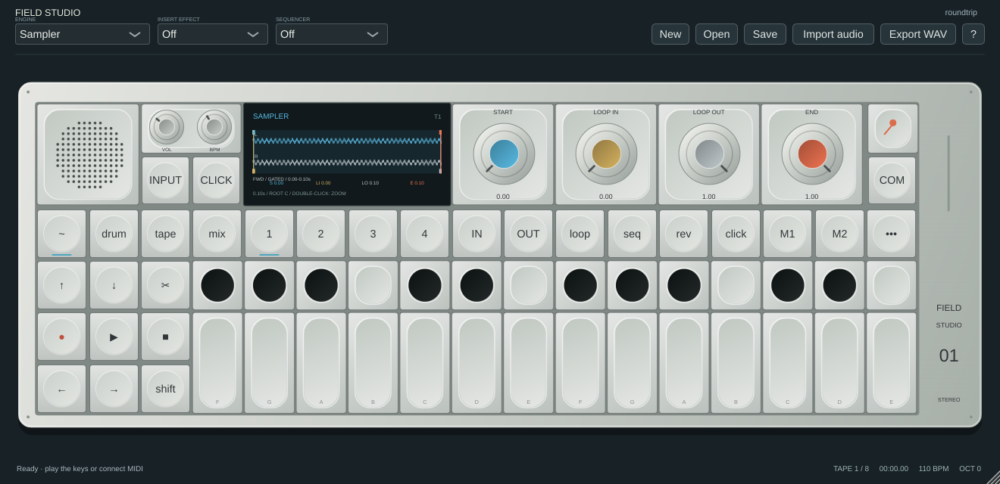

# Field Studio

A native synthesizer, sampler and four-track stereo tape instrument inspired by the OP–1 field workflow. Builds a standalone application and VST3 from the same C++ audio engine; macOS also builds AU.



This is an independently written recreation. **Exact feature, visual and sonic parity has not been established.** No manufacturer DSP, firmware, factory samples, fonts, logos or extracted artwork are bundled. See [the parity ledger](docs/PARITY.md) for concrete differences and [research findings](docs/research/FIRMWARE_FINDINGS.md) for what the firmware inspection actually established.

## Controller mapping

Right-click a knob and choose **MIDI learn**, then move a control on your Faderfox, BeatStep or other MIDI controller. Absolute pickup/jump, three relative encoder modes and reversed direction are supported. Assignments save with projects/DAW state; reusable profiles are under **COM → MIDI learn / controller mappings**. See [controller setup and limits](docs/CONTROLLERS.md).

## Downloads

[Field Studio 0.2.1 beta 1 downloads](https://github.com/stevenmcsorley/field-studio/releases/tag/v0.2.1-beta.1) are published after all automated release gates pass. The pipeline packages Windows x64 standalone/VST3, macOS universal standalone/VST3/AU and Linux x86_64 standalone/VST3, with checksums and complete corresponding source. See [beta notes](docs/RELEASE_NOTES.md) and [build/release status](docs/BUILD_STATUS.md). Binaries are unsigned development builds.

## Run the Linux build

```sh
cd field-studio
./scripts/run.sh
```

The standalone executable is `build/FieldStudio_artefacts/Release/Standalone/Field Studio`. Use its **Options** menu for your audio interface, buffer size and MIDI inputs. The native application needs a graphical desktop and an audio output device. If recording external audio, select your input device and unmute input in the standalone audio settings, then enable **INPUT** in the instrument.

The VST3 bundle is `build/FieldStudio_artefacts/Release/VST3/Field Studio.vst3`. Point your DAW's VST3 scanner at that directory, or copy the entire bundle into your user VST3 directory (`~/.vst3` on Linux). Four optional stereo tape-stem buses are available in hosts that support multi-output instruments, alongside the main stereo mix.

## Play and record

- Click the piano keys or play **A W S E D R F G Y H U J K O L P ; [ ' Z X C V B**. The two-octave layout starts at F (MIDI53); **− / +** changes octave. **Esc** releases notes; **Space** starts/stops tape playback.
- Select **Synth / Drum**, then **1–4** for engine, envelope, patch effect and modulation. The four coloured knobs edit the displayed page. Drag vertically; double-click restores its default. On the melodic T2 envelope page, Shift exposes Poly/Mono/Legato/Unison, portamento for overlapping mono/legato notes, pitch-bend range and patch volume. Hold **Shift**, or latch the Shift button, for alternate controls.
- **Import audio** loads WAV/AIFF/FLAC/Ogg into the sampler. Sampler knobs and draggable stereo-waveform markers edit start, loop-in, loop-out and end; double-click the waveform to zoom. Supported OP-1 sample patches restore root tuning and sample markers; drum kits restore nonuniform regions and per-pad settings. COM → Import details explains conversion limits. Modeled synth patch parameters are retained but not translated to an identical sound. **COM → Sampler → Resample main output** captures synth/tape through the master processing. The COM menu controls reverse, looping and one-shot playback. In drum sampler mode, select any of 24 pads to edit its trim, tuning, level, pan, playback mode or choke group.
- **Master volume**: 1 is unity gain; 2 adds approximately 6 dB. Imported samples preserve their source level before velocity, envelopes, patch/pad gain and effects. Quiet source recordings can use the master boost; samples are not automatically normalized.
- **Shift + Record** captures an input sample; press it again to finish. Automatic capture limits are six seconds for melodic sampling and twenty seconds for drums. File import supports up to 120 seconds.
- **Tape:** choose a track with **1–4**, then **Record** and play. Recording starts immediately and overdubs the selected stereo track. **IN / OUT** define the loop. Click the tape display to seek; Shift-drag selects a region. **Lift / Drop / Split** edit tape; Shift changes these to **Undo / Redo / Clear**. **Tape edits → Tape editing** adds grouped copy/lift/drop, merge, join, slide, bounce, beat snapping and record count-in. Hold the brake/reverse/chop buttons for temporary tape tricks. See [tape editing](docs/TAPE_EDITING.md) for controls and limits. Eight tape banks are in **COM → Tape bank**.
- **M1 / M2** recall mixer/effect/tape-speed memories; Shift stores them. In sequencer view, these buttons page through the step grid instead.
- **Mixer:** T1 edits track level (Shift: pan); click M/S to mute/solo. T2 is three-band EQ/drive, T3 independent master FX, T4 dynamics. In patch/master FX, Shift + the orange knob controls the wet/dry mix.
- Choose a sequencer and hold a key to run it. Endless/Pattern expose a note/rest grid; Shift-click changes pitch. Finger has 16 independent 32-step pattern banks selected by keys or COM. Sketch is a real X/Y drawing canvas. Tombola rotates a physical container; bouncing notes trigger on collisions. COM controls lengths and latch; up to 999 Endless steps are supported. Hold mode latches a chord; **Esc** or **COM → Release held sequencer notes** clears it.
- **COM → Album** records the live processed output to side A or B, listens back, clears or exports either side. Each side keeps its capture rate and is embedded in the project.
- **COM → Store/Recall patch** accesses eight synth and eight drum slots. **Save** embeds samples, all tape banks, pad settings, sequences, patch slots, memories and parameters in a `.field` project. **Export WAV** renders the current tape's stereo mix, including tape colour, EQ and master processing.

The plugin can follow DAW tempo, play/stop and seek through **COM → Follow DAW transport and tempo**. Local tape speed still controls varispeed between host timeline jumps. MIDI routing offers channel and message filters, per-channel sustain, clock receive/send, controller output, thru and sample-timed sequencer output. Documented CC destinations and SPP sequencer positioning are supported; exact hardware policies remain unverified. See [MIDI controls and limits](docs/MIDI.md). Program changes are applied on the message thread to avoid loading sample data on the audio thread.

## Build

Requirements: CMake3.22+, a C++17 toolchain and JUCE8.0.16-security (pinned commit). `scripts/build.sh` configures, builds and tests with two compiler jobs by default. CMake uses `vendor/JUCE` when present; otherwise it fetches the pinned official source. Linux prerequisites include ALSA, FreeType/fontconfig, X11/Xrandr/Xinerama/Xcursor and OpenGL development headers; `xvfb` permits offscreen GUI tests. On Ubuntu 24.04:

```sh
sudo apt-get update
sudo apt-get install -y pkg-config libasound2-dev libfreetype-dev libfontconfig1-dev libx11-dev libxrandr-dev libxinerama-dev libxcursor-dev libgl1-mesa-dev xvfb
```

JUCE discovers FreeType and fontconfig together through pkg-config, so both development packages are required even when only FreeType appears in a compiler error.

```sh
./scripts/build.sh
# DSP core only, without JUCE or a desktop:
cmake -S . -B build-core -DFIELD_BUILD_PLUGIN=OFF
cmake --build build-core
ctest --test-dir build-core --output-on-failure
```

Windows: configure with Visual Studio2022 and build `--config Release`. macOS: configure with Xcode or Makefiles; universal builds use `-DCMAKE_OSX_ARCHITECTURES="arm64;x86_64"`. The workflow in `.github/workflows/build.yml` builds Windows, macOS and Linux artifacts when the project is placed in a repository. Local Linux builds pass the automated suite; Windows and macOS have also passed build/tests in GitHub Actions. The Ubuntu CI dependency fix passed the full three-platform workflow; see [build status](docs/BUILD_STATUS.md). Real audio-device and commercial DAW testing, code signing and installers remain outstanding.

## Verification

`ctest --test-dir build --output-on-failure` runs audio-core, plugin/project/UI, MIDI clock/routing, preset-format, parameter translation and Linux native VST3-host tests. Use `xvfb-run -a` on headless Linux. Core ownership tests also pass AddressSanitizer and UndefinedBehaviorSanitizer and check both allocation and deallocation on tested realtime paths. Native VST3 tests instantiate the actual module with optional stems disabled and enabled; they are not a substitute for testing every DAW. Public preset metadata was independently checked against 167 research fixtures; its raw hardware knob values are preserved, not guessed into identical sounds.

```sh
xvfb-run -a build/field_plugin_tests_artefacts/Release/field_plugin_tests docs/screenshots
```

This renders all five modes and the synth module pages for visual inspection. Firmware inspection did not recover executable DSP or screen assets; animations and algorithms here are original interpretations. See [screens and visual checks](docs/SCREENS.md), [preset import](docs/PRESET_IMPORT.md), [VST3 test scope](docs/VST3_SMOKE.md), and [dependency provenance](docs/THIRD_PARTY.md).

## Current engineering limits

Tape audio is held in RAM, with six minutes per track and eight banks. Long projects require substantial memory. Up to seven undo snapshots are retained, subject to a soft256MiB budget; project import has a512MiB decompressed-state limit. Undo history and hardware preset-file export are not persisted. Sequencer algorithms, DBox-style synthesis, tape colour and effects differ from the original hardware; see the parity ledger.

The [audio ownership rewrite](docs/AUDIO_REWRITE_PROGRESS.md) now includes lock-free keyboard handoff, deferred MIDI parameter notifications and immutable sample lifetimes. Live tape, undo history, albums and sample capture now use paged snapshot storage. Saves flatten tape/capture generations and mix exports render after releasing the engine lock; the full ownership migration remains in progress.

Large record preparation, edits, project/sample loading, serialization and previews now run outside the live lock, with revision checks and a default 2 GiB tape-pool reservation cap. The wrapper still uses a short commit/UI lock and can skip a contended block. It is not yet certified for seamless live performance; see [known issues](docs/KNOWN_ISSUES.md). The core render is allocation-free, but full plugin performance parity and long-session stress validation remain open. Models of radio, embedded sensors, battery/speaker hardware and device-specific USB/BLE behaviour are outside this software implementation.

## License

Our original code and graphics are **MIT licensed**: free to use, change, share and sell with the notice retained. Packaged binaries include JUCE and are distributed under **AGPLv3**, with complete corresponding source alongside the downloads. JUCE's terms still apply to the combined app. See [LICENSING.md](LICENSING.md) and [LICENSE](LICENSE).
