# Field Studio

A native synthesizer, sampler and four-track stereo tape instrument inspired by the OP–1 field workflow. Builds a standalone application and VST3 from the same C++ audio engine; macOS also builds AU.

**[Download the latest beta](https://github.com/stevenmcsorley/field-studio/releases/tag/v0.2.2-beta.8)** · [VST3 setup](#vst3-and-daw-workflow) · [Recent features and screenshots](#recent-improvements) · [Controller mapping](#controller-mapping)


This is an independently written recreation. **Exact feature, visual and sonic parity has not been established.** No manufacturer DSP, firmware, factory samples, fonts, logos or extracted artwork are bundled. See [the parity ledger](docs/PARITY.md) for concrete differences and [research findings](docs/research/FIRMWARE_FINDINGS.md) for what the firmware inspection actually established.

## What you can make

Play synths and drums, import samples, build a sequence, record it onto four stereo tape tracks, then mix and export the result. The standalone app and plugin share the same instrument and `.field` projects.

- **Sound design:** synth engines, DBox drums, stereo sampling, ADSR, modulation, insert effects and a separate master effect. Includes 45 original starter presets.
- **Sequencing:** polyphonic Endless/Pattern storage and an editable Pattern grid, sixteen Finger pattern banks with up to 32 steps each, plus Arpeggio, Hold, Sketch and Tombola. Endless supports up to 999 steps.
- **Tape and arrangement:** eight tape banks, four stereo tracks per bank, six minutes per track at normal speed, overdubbing, loops, lift/drop/split, grouped edits, bounce and momentary tape tricks.
- **Mixing:** track levels/pans/mutes/solos, three-band master EQ with Amount and band bypass, master effects, dynamics and stereo WAV export. Record the live output to Album sides A/B too.
- **Presets and controllers:** eight synth and eight drum sound slots, dated snapshots, preset browsing, nested user folders, MIDI learn and reusable controller profiles.

## Recent improvements

**Grid, Mother, Dimension and DNA LCDs:** rebuilt Grid's floor/wall projection, wire boxes, arrows and thin numeric readouts; Mother now uses the reference's tunnel grid, foreground/rear figures and gate bracket. Dimension uses the paired 2:3 Lissajous knot, corrected plot placement and rounded resonance peak. DNA has a dedicated linked hexadecimal-tile screen, terminal dots and noise strip. All four retain parameter-driven rendering. These are closer reference-based redraws; pixel-perfect fonts, hardware readout laws and animation parity remain unverified. [LCD comparison notes and native details](docs/LCD_FIDELITY.md).

**Vocoder and sampling:** the vocoder now has a dedicated head/voice LCD and independent Waveform, Formant, 4–16 Bands and dry/wet Mix controls. The orange microphone button opens a source picker and Standby/Recording page with live meter, threshold, input gain and 6/20/60/120-second limits. Click ARM or press Record; Shift-click ARM enables held-key capture. Empty captures preserve your previous sample. Choose microphone/interface/DAW input, Windows system loopback, Linux monitor sources, routed macOS virtual inputs, imported files or Field Studio's internal output resampling. macOS computer audio needs routing through a virtual device; automatic app/process capture is not included. [Step-by-step setup, controls and limits](docs/VOCODER_SAMPLING.md).

**Tempo and generic MIDI sync:** a dedicated tempo LCD shows Song/Play BPM, tape ratio, cm/s and IPS, link state, clock receipt and metronome level. Blue/Shift-blue provide coarse/fine adjustment; tap the BPM display or press T, and use arrows to nudge. Added three original click sounds, optional tape-tempo linking and received-clock relay. Free, Beat Match (MIDI send), MIDI receive and DAW follow work with compatible OS-visible MIDI devices. Relay uses standard 24-PPQN MIDI; PO/analogue pulse output is not implemented. [Controls, routing and parity limits](docs/TEMPO_SYNC.md).

**Hearing the metronome:** open the tempo page with the metronome-shaped button, click the centre illustration to enable the click, turn the orange level knob up, then press **Play / Space**. It sounds during tape playback and recording count-in; it does not run while stopped. Shift-click the centre to cycle Click / Wood / Beep, or Shift-click the tempo button to toggle it. The swinging illustration appears in Free mode during playback; MIDI modes show a clock symbol. Count-in clicks even with the ordinary metronome off; orange level zero silences both.

**Sequencers:** new Arpeggio, Endless, Hold, Pattern and melodic/drum Finger LCDs, with mode-specific normal/Shift encoder roles. Pattern and Finger store up to eight notes per step; projects preserve chords and step velocities. Added divisions, trigger masks, direction, manual Endless stepping, rotation, play modes and Hold split/mono controls. [Sequencer guide and remaining differences](docs/SEQUENCERS.md).

**AI control through MCP:** an optional local integration exposes just two tools, `search` and `execute`, following the Cloudflare Code Mode approach. Find schemas on demand, then batch parameter changes, chords, notes and transport commands. Portable operation plans work on all platforms; sandboxed JavaScript composition currently requires Linux. Enable local AI control from COM and configure your MCP client using the [setup guide](docs/MCP.md). It is packaged with downloads, not automatically registered in your client.

**Audio drivers:** Windows standalone builds now enable ASIO alongside the existing backends. macOS uses native CoreAudio; VST3/AU use the audio driver selected by your DAW. [Driver setup and testing limits](docs/AUDIO_BACKENDS.md).

**String, Voltage, Pulse and Sampler:** dedicated full-LCD synth illustrations now follow the guide layouts. String has independent decay/stereo-detune and impulse types; Voltage has modulation, ground noise, phase filtering and detune; Pulse has independent filter, amplitude, second pulse and modulation. Sampler displays actual stereo audio with coloured boundaries and loop-fade shading. Hold Shift for direction, fine tune, loop fade and gain; zoom around any marker from its knob's right-click menu or the LCD header. Fine tune, fade and gain support host automation, MIDI learn and project/preset state. [Controls and compatibility](docs/INSTRUMENT_SCREENS.md).

**Master Out, Grid and Mother:** Master Out now has independent left/right meters, output faders, peak indicators and Drive/Release readouts; hold Shift while adjusting blue/ochre to set both output levels together. Grid has a three-dimensional size/feedback illustration. Mother has a perspective room and distance/gate/colour controls. Both spatial effects now give their four native controls dedicated sound paths, including a true orange dry/wet mix. Master Drive adds makeup gain and saturation with release-dependent compression. [Controls, compatibility and parity limits](docs/MASTER_SPATIAL.md).

**Mixer and EQ:** the mixer has four audio-driven tape-track meters, pan pointers and coloured level readouts. Shift + T1–T4 mutes tracks on the mixer page. EQ has separate band faders, a response illustration, Amount and saved band/overall bypass settings. [Controls and limits](docs/MIXER_EQ.md).

**Tape:** the new reel LCD follows playback, reverse and scrubbing, with timecode, speed, loop markers and compact track lanes. Hold tape keys 4/5/6 for brake/reverse/chop. [Tape guide](docs/TAPE_EDITING.md).

**Synths, effects and presets:** Dimension and DSynth have dedicated LCD layouts. CWO now blends lower/upper sidebands, with control-driven internal motion and feedback-dependent dry sound. Delay has Range-linked circles, input-level control that preserves circulating echoes, and slower-clock colour. Preset browsing adds dated snapshots, nested folders, rename, copy/move and delete. [Effects research](docs/research/EFFECT_VISUAL_MOTION.md) · [Presets](docs/PRESETS.md).

**Saving and exporting:** project saves and WAV exports run on a bounded background worker. Prepared-media and tape-reservation changes reduce heavy work inside the live lock; the remaining live-performance limits are described below.

These are native screenshots of Field Studio. Screen artwork and DSP remain independent approximations; the EQ curve illustrates settings rather than a measured response.

| Mixer | Equalizer |
|---|---|
| [](docs/screenshots/mixer-reference.png) | [](docs/screenshots/eq-reference.png) |
| **Tape reels and transport** | **Preset browser** |
| [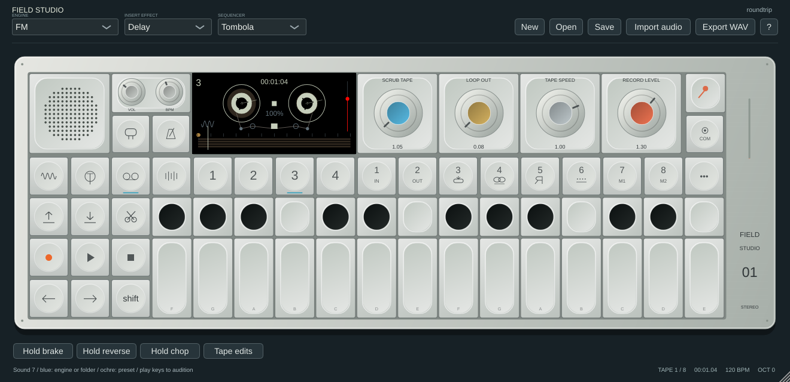](docs/screenshots/tape-reference.png) | [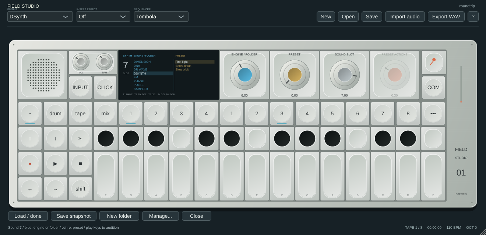](docs/screenshots/preset-browser.png) |
| **Master Out** | **Grid** |
| [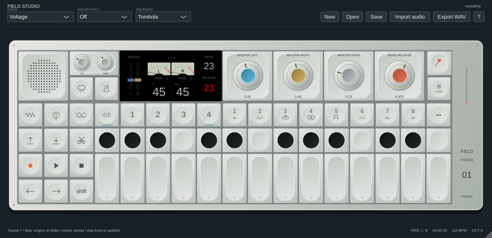](docs/screenshots/master-out-reference.png) | [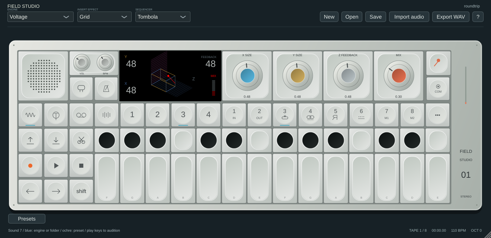](docs/screenshots/grid-reference.png) |
| **Mother** | **CWO** |
| [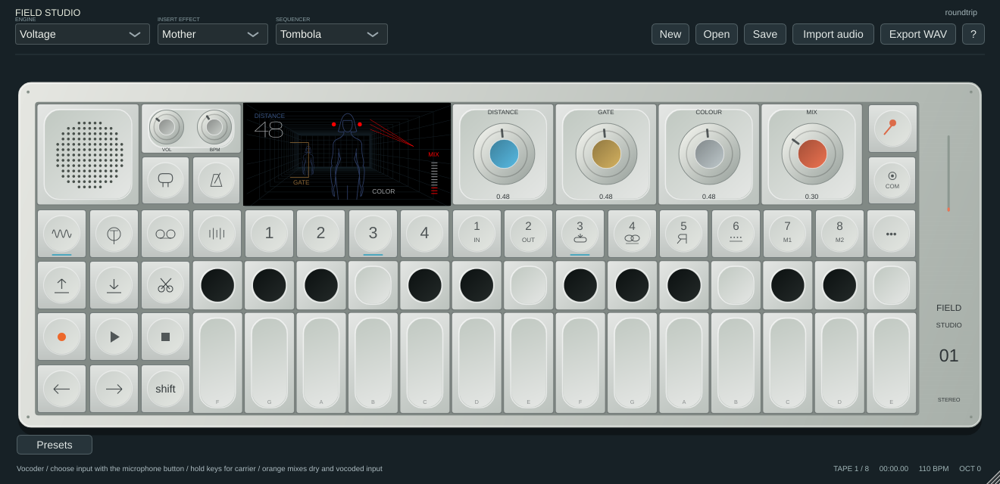](docs/screenshots/mother-reference.png) | [](docs/screenshots/cwo-reference.png) |
| **String** | **Voltage** |
| [](docs/screenshots/string-reference.png) | [](docs/screenshots/voltage-reference.png) |
| **Pulse** | **Stereo Sampler** |
| [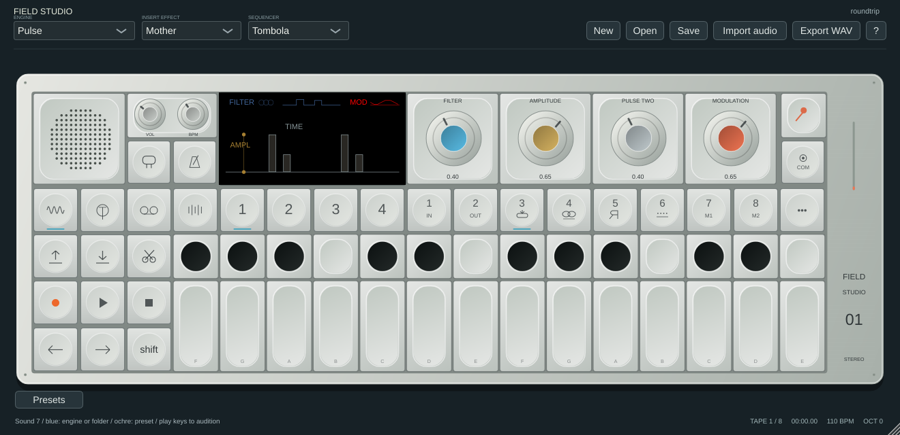](docs/screenshots/pulse-reference.png) | [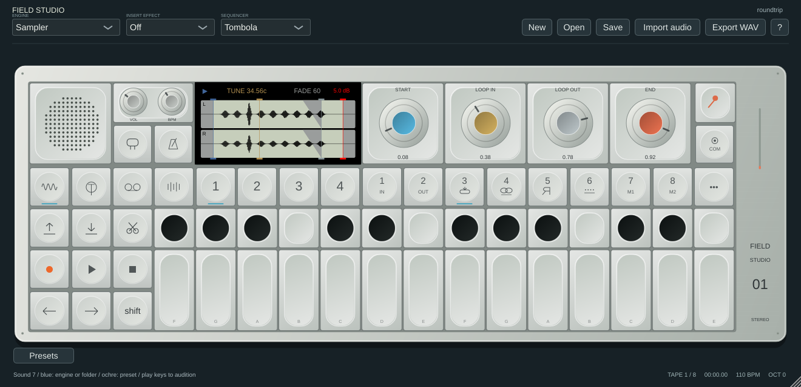](docs/screenshots/sampler-reference.png) |
| **DNA synth** | **Dimension LCD detail** |
| [](docs/screenshots/dna-reference.png) | [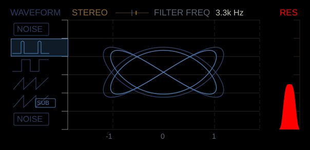](docs/screenshots/lcd-dimension.png) |
| **Dimension synth** | **DSynth** |
| [](docs/screenshots/dimension-reference.png) | [](docs/screenshots/dsynth-reference.png) |

| **Arpeggio** | **Endless** |
| [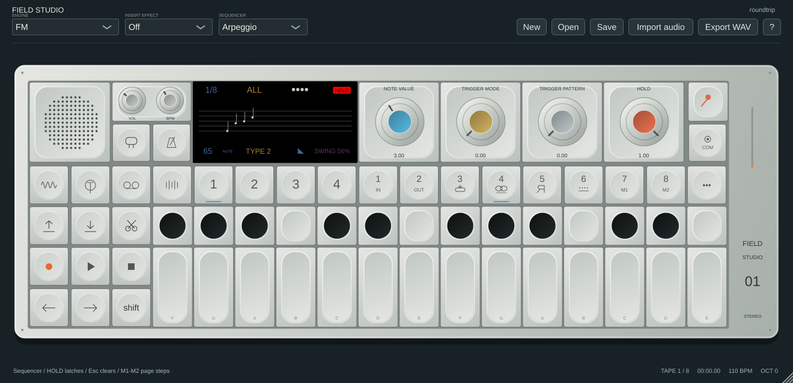](docs/screenshots/arpeggio-reference.png) | [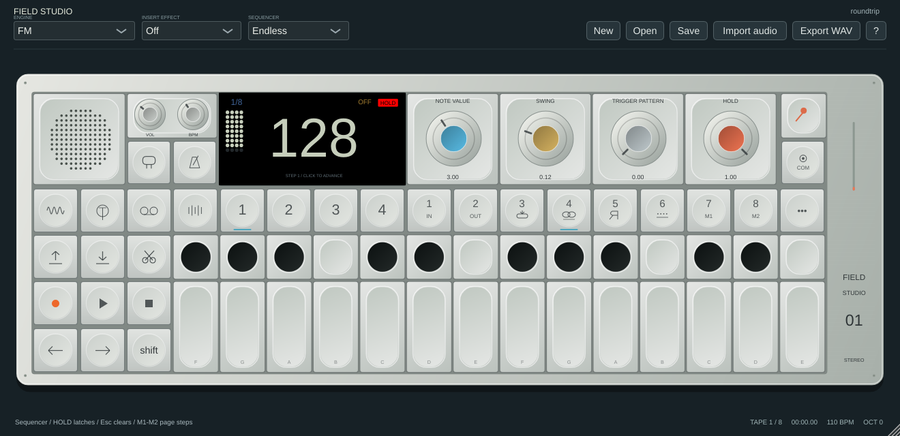](docs/screenshots/endless-reference.png) |
| **Hold** | **Pattern** |
| [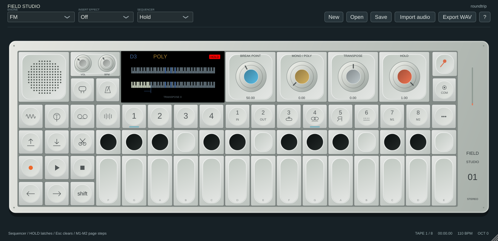](docs/screenshots/hold-reference.png) | [](docs/screenshots/pattern-reference.png) |
| **Finger** | **Finger drum** |
| [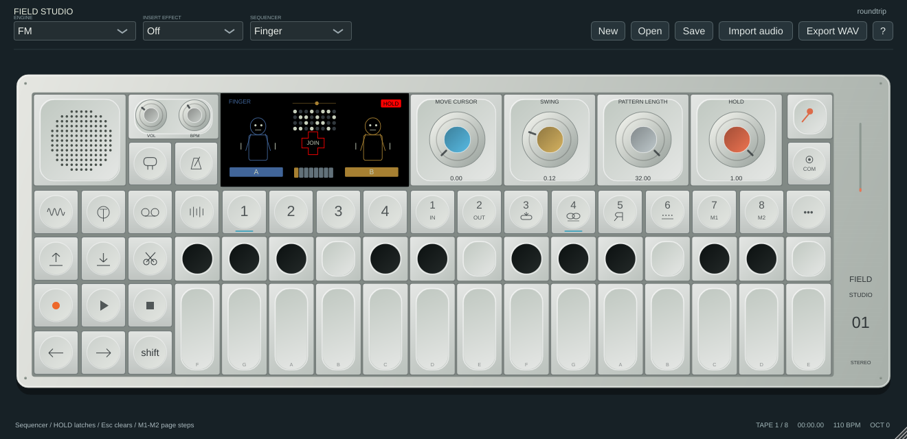](docs/screenshots/finger-reference.png) | [](docs/screenshots/finger-drum-reference.png) |

| **Tempo: Beat Match / MIDI master** | **Tempo: incoming MIDI + relay** |
| [](docs/screenshots/tempo-beat-match.png) | [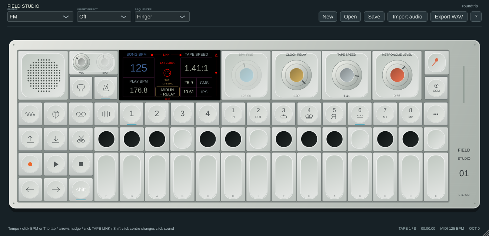](docs/screenshots/tempo-midi-relay.png) |
| **Tempo: Free** | **Tempo: waiting for MIDI clock** |
| [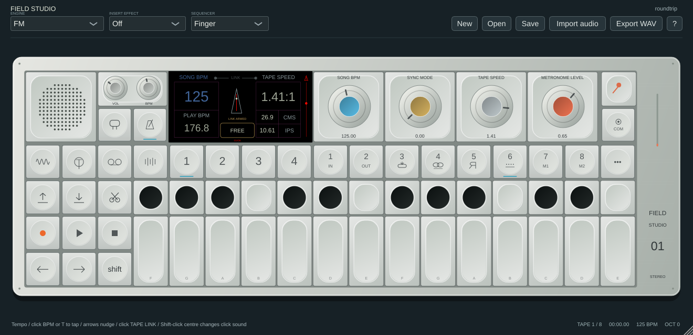](docs/screenshots/tempo-free.png) | [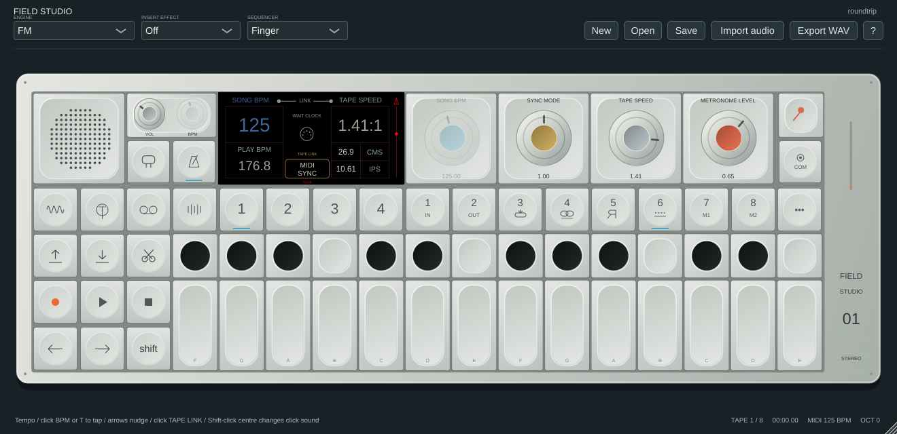](docs/screenshots/tempo-midi-wait.png) |

| **Vocoder: carrier, formant, bands and mix** | **Sampling: recording** |
| [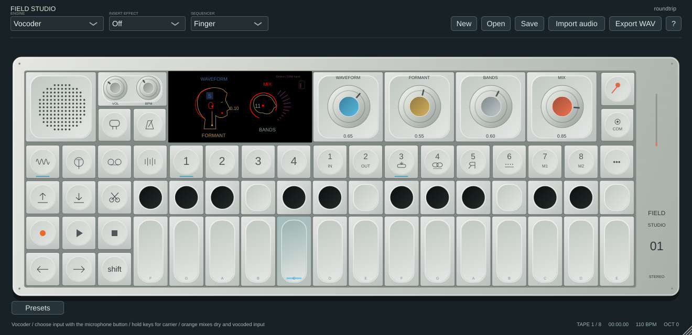](docs/screenshots/vocoder-reference.png) | [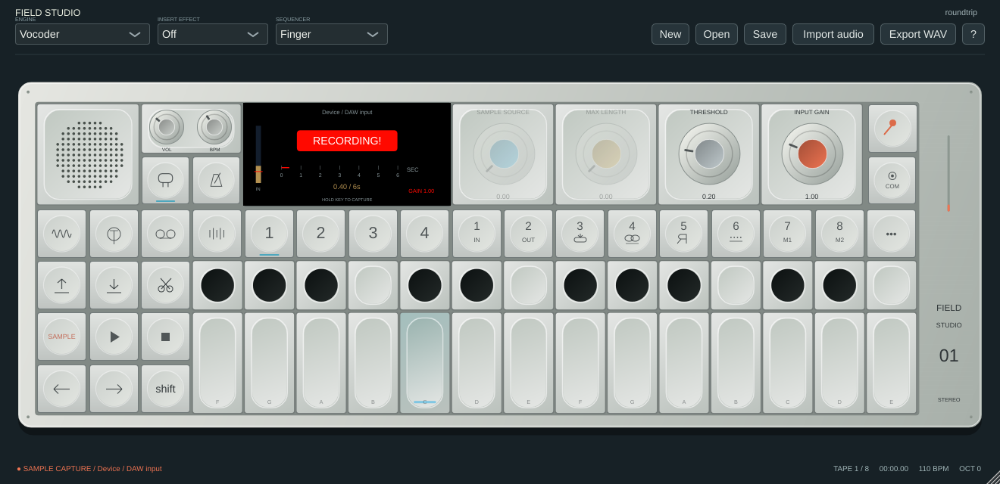](docs/screenshots/sampling-recording.png) |
| **Sampling: held-key standby** | **Sampling setup guide** |
| [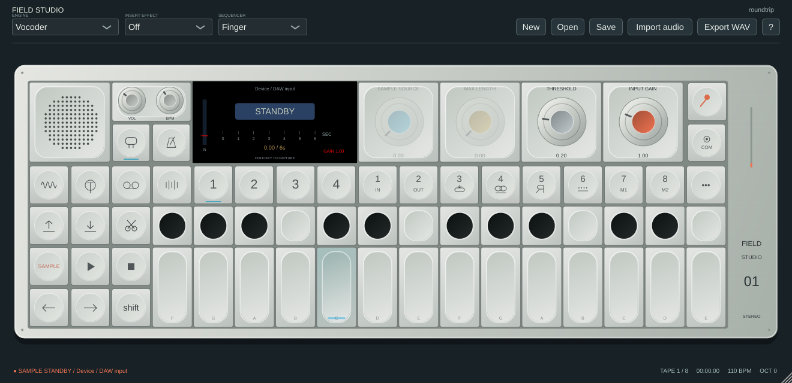](docs/screenshots/sampling-standby.png) | [Microphone, computer audio and internal resampling instructions](docs/VOCODER_SAMPLING.md) |

<details>
<summary>CWO and Delay animated previews</summary>

CWO mechanisms respond to control changes; Delay circles follow Range. Animation timing is approximate.

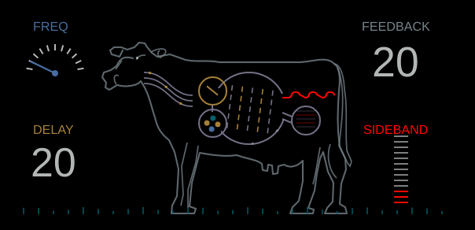

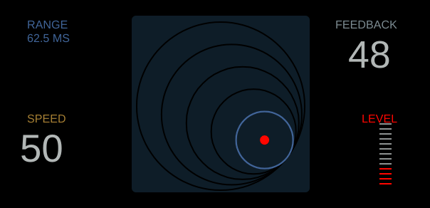

</details>

## VST3 and DAW workflow

Field Studio is an **instrument plugin**: load it on a MIDI/instrument track, route notes to it and hear the main stereo output. The same interface supports synthesis, sampling, sequencing, tape recording and mixing inside the DAW. macOS downloads also include AU.

### Tested by the user

The project owner reports successful hands-on use of the plugin, DAW automation, Faderfox control assignment and an Arturia BeatStep (1 November 2026).

| Workflow | Reported result |
|---|---|
| Plugin operation | Works well in the tested setup |
| DAW automation | Working well |
| Faderfox | Connected; controls assigned and working |
| Arturia BeatStep | Working with Field Studio |

The DAW, OS, Faderfox model and exact controller modes were not recorded with this report. These are user-confirmed results for that setup; broader host/platform and controller-mode coverage remains open. Automated release builds/tests also pass on Windows, macOS and Linux.

### Install the plugin

Download and extract the archive for your OS. Copy the **entire bundle**, then rescan plugins in your DAW.

| Platform | Plugin location |
|---|---|
| Windows x64 | Copy `VST3/Field Studio.vst3` into `C:\Program Files\Common Files\VST3\` or a VST3 folder supported by your DAW. The system folder requires administrator access. |
| macOS, Apple Silicon or Intel | Copy `VST3/Field Studio.vst3` into `~/Library/Audio/Plug-Ins/VST3/`. For AU, copy `AU/Field Studio.component` into `~/Library/Audio/Plug-Ins/Components/`. |
| Linux x86_64 | Copy `VST3/Field Studio.vst3` into `~/.vst3/`, or add its location to your DAW's VST3 scan paths. Builds require glibc 2.35+. |

The format is **VST3**; VST2 is not included. Portable downloads include `INSTALL.md` and remain unsigned/not notarized. macOS requires 11 or newer. The standalone executable/app is included separately in each archive.

### Automate and connect hardware

1. Add Field Studio to an instrument track and enable MIDI input/monitoring as required by your DAW.
2. Use the DAW's automation parameter list or automation learn to control exposed synth macros, envelopes, effects, master EQ/Amount and output parameters. Enable the DAW's automation read/write mode for the workflow you want.
3. Route your controller's MIDI to the same track. Right-click a Field Studio knob, select **MIDI learn**, then move the hardware control. Choose pickup for absolute knobs/faders, or the matching relative mode for endless encoders.
4. Save the DAW project to retain plugin state and assignments. Export a controller profile under COM to reuse mappings in another project. `.field` files also preserve the instrument project independently of the DAW.

Host automation and hardware mappings are separate routes to controls. MIDI pickup re-arms when host automation changes the software value. The COM mapping list also exposes track levels/pans/mutes/solos, pad controls and tape actions; these are MIDI destinations, not all separate host automation parameters.

Enable **COM → Follow DAW transport and tempo** to follow the host's tempo, play/stop and seeks. Tape retains its own varispeed between host timeline jumps. Four optional stereo tape-stem output buses are available alongside the main stereo mix when the DAW supports multiple outputs; enable and route those buses in the host. [MIDI and sync](docs/MIDI.md) · [Controller setup](docs/CONTROLLERS.md) · [Automated VST3 test scope](docs/VST3_SMOKE.md).

## Controller mapping

Right-click a knob and choose **MIDI learn**, then move a control on your Faderfox, BeatStep or other MIDI controller. Absolute pickup/jump, three relative encoder modes and reversed direction are supported. Assignments save with projects/DAW state; reusable profiles are under **COM → MIDI learn / controller mappings**. See [controller setup and limits](docs/CONTROLLERS.md).

## Downloads

[Field Studio 0.2.2 beta 4 downloads](https://github.com/stevenmcsorley/field-studio/releases/tag/v0.2.2-beta.8) are available for Windows, macOS and Linux. All automated release gates passed. The pipeline packages Windows x64 standalone/VST3, macOS universal standalone/VST3/AU and Linux x86_64 standalone/VST3, with checksums and complete corresponding source. See [beta notes](docs/RELEASE_NOTES.md) and [build/release status](docs/BUILD_STATUS.md). Binaries are unsigned development builds.

## Run the Linux build

```sh
cd field-studio
./scripts/run.sh
```

The standalone executable is `build/FieldStudio_artefacts/Release/Standalone/Field Studio`. Use its **Options** menu for your audio interface, buffer size and MIDI inputs. The native application needs a graphical desktop and an audio output device. If recording external audio, select your input device and unmute input in the standalone audio settings, then enable **INPUT** in the instrument.

The VST3 bundle is `build/FieldStudio_artefacts/Release/VST3/Field Studio.vst3`. Point your DAW's VST3 scanner at that directory, or copy the entire bundle into your user VST3 directory (`~/.vst3` on Linux). Four optional stereo tape-stem buses are available in hosts that support multi-output instruments, alongside the main stereo mix.

## Play and record

- Click the piano keys or play **A W S E D R F G Y H U J K O L P ; [ ' Z X C V B**. The two-octave layout starts at F (MIDI53); **− / +** changes octave. **Esc** releases notes; **Space** starts/stops tape playback.
- Select **Synth / Drum**, then **1–4** for engine, envelope, patch effect and modulation. The four coloured knobs edit the displayed page. Drag vertically; double-click restores its default. On the melodic T2 envelope page, Shift exposes Poly/Mono/Legato/Unison, portamento for overlapping mono/legato notes, pitch-bend range and patch volume. Hold **Shift**, or latch the Shift button, for alternate controls.
- **Import audio** loads WAV/AIFF/FLAC/Ogg into the sampler. Sampler knobs and draggable stereo-waveform markers edit start, loop-in, loop-out and end; double-click the waveform to zoom. Supported OP-1 sample patches restore root tuning and sample markers; drum kits restore nonuniform regions and per-pad settings. COM → Import details explains conversion limits. Modeled synth patch parameters are retained but not translated to an identical sound. **COM → Sampler → Resample main output** captures synth/tape through the master processing. The COM menu controls reverse, looping and one-shot playback. In drum sampler mode, select any of 24 pads to edit its trim, tuning, level, pan, playback mode or choke group.
- **Master volume**: 1 is unity gain; 2 adds approximately 6 dB. Imported samples preserve their source level before velocity, envelopes, patch/pad gain and effects. Quiet source recordings can use the master boost; samples are not automatically normalized.
- **Shift + Record** captures an input sample; press it again to finish. Automatic capture limits are six seconds for melodic sampling and twenty seconds for drums. File import supports up to 120 seconds.
- **Tape:** choose a track with **1–4**, then **Record** and play. Recording starts immediately and overdubs the selected stereo track. **IN / OUT** define the loop. Click the tape display to seek; Shift-drag selects a region. **Lift / Drop / Split** edit tape; Shift changes these to **Undo / Redo / Clear**. **Tape edits → Tape editing** adds grouped copy/lift/drop, merge, join, slide, bounce, beat snapping and record count-in. Hold tape keys **4/5/6** (or the brake/reverse/chop buttons) for temporary tape tricks. Tape mode uses a reel LCD with position-driven motion, timecode, loop markers and compact track lanes. See [tape editing](docs/TAPE_EDITING.md) for controls and limits. Eight tape banks are in **COM → Tape bank**.
- **M1 / M2** recall mixer/effect/tape-speed memories; Shift stores them. In sequencer view, these buttons page through the step grid instead.
- **Mixer:** T1 edits track level (Shift: pan); Shift + T1–T4 toggles track mutes. Click a channel to mute, Shift-click to solo. T2 is three-band EQ/Amount (Shift + orange retains drive), T3 independent master FX, T4 dynamics. For CWO/Delay, Shift fine-adjusts the same four controls; COM → Effect wet/dry override exposes the optional overall blend. Other patch/master FX retain Shift + orange for wet/dry. **CWO** has a full cow LCD with control-driven internal motion, a lower/upper sideband blend and feedback-dependent dry input. **Delay** has range-driven circles and input-level/buffer-colour behaviour. See [CWO controls and compatibility](docs/CWO.md).
- Choose a sequencer and hold a key to run it. Endless/Pattern expose a note/rest grid; Shift-click changes pitch. Finger has 16 independent 32-step pattern banks selected by keys or COM. Sketch is a real X/Y drawing canvas. Tombola rotates a physical container; bouncing notes trigger on collisions. COM controls lengths and latch; up to 999 Endless steps are supported. Hold mode latches a chord; **Esc** or **COM → Release held sequencer notes** clears it.
- **COM → Album** records the live processed output to side A or B, listens back, clears or exports either side. Each side keeps its capture rate and is embedded in the project.
- **Presets:** in Synth/Drum, sound keys **1–8** recall complete sounds. **Shift + a sound key** opens the engine/preset browser; blue selects an engine/folder and ochre loads a preset. **Hold a sound key for two seconds** to save a dated snapshot. **Presets** below the instrument provides snapshots, user folders, rename, copy/move and delete. Includes 45 original starter sounds, not the OP-1 factory bank. See [the preset guide](docs/PRESETS.md). **COM → Store/Recall patch** also accesses the eight synth and eight drum slots. **Save** embeds samples, all tape banks, pad settings, sequences, patch slots, memories and parameters in a `.field` project. **Export WAV** renders the current tape's stereo mix, including tape colour, EQ and master processing.

The plugin can follow DAW tempo, play/stop and seek through **COM → Follow DAW transport and tempo**. Local tape speed still controls varispeed between host timeline jumps. MIDI routing offers channel and message filters, per-channel sustain, clock receive/send, controller output, thru and sample-timed sequencer output. Documented CC destinations and SPP sequencer positioning are supported; exact hardware policies remain unverified. See [MIDI controls and limits](docs/MIDI.md). Program changes are applied on the message thread to avoid loading sample data on the audio thread.

## Build

Requirements: CMake3.22+, a C++17 toolchain and JUCE8.0.16-security (pinned commit). `scripts/build.sh` configures, builds and tests with two compiler jobs by default. CMake uses `vendor/JUCE` when present; otherwise it fetches the pinned official source. Linux prerequisites include ALSA, FreeType/fontconfig, X11/Xrandr/Xinerama/Xcursor and OpenGL development headers; `xvfb` permits offscreen GUI tests. On Ubuntu 24.04:

```sh
sudo apt-get update
sudo apt-get install -y pkg-config libasound2-dev libfreetype-dev libfontconfig1-dev libx11-dev libxrandr-dev libxinerama-dev libxcursor-dev libgl1-mesa-dev xvfb
```

JUCE discovers FreeType and fontconfig together through pkg-config, so both development packages are required even when only FreeType appears in a compiler error.

```sh
./scripts/build.sh
# DSP core only, without JUCE or a desktop:
cmake -S . -B build-core -DFIELD_BUILD_PLUGIN=OFF
cmake --build build-core
ctest --test-dir build-core --output-on-failure
```

Windows: configure with Visual Studio2022 and build `--config Release`. macOS: configure with Xcode or Makefiles; universal builds use `-DCMAKE_OSX_ARCHITECTURES="arm64;x86_64"`. The workflow in `.github/workflows/build.yml` builds Windows, macOS and Linux artifacts when the project is placed in a repository. Local Linux builds pass the automated suite; Windows and macOS have also passed build/tests in GitHub Actions. The Ubuntu CI dependency fix passed the full three-platform workflow; see [build status](docs/BUILD_STATUS.md). User testing confirms plugin operation, automation, Faderfox assignment and BeatStep use in one setup. Broader device/DAW coverage, code signing and installers remain outstanding.

## Verification

`ctest --test-dir build --output-on-failure` runs audio-core, plugin/project/UI, MIDI clock/routing, preset-format, parameter translation and Linux native VST3-host tests. Use `xvfb-run -a` on headless Linux. Core ownership tests also pass AddressSanitizer and UndefinedBehaviorSanitizer and check both allocation and deallocation on tested realtime paths. Native VST3 tests instantiate the actual module with optional stems disabled and enabled; they are not a substitute for testing every DAW. Public preset metadata was independently checked against 167 research fixtures; its raw hardware knob values are preserved, not guessed into identical sounds.

```sh
xvfb-run -a build/field_plugin_tests_artefacts/Release/field_plugin_tests docs/screenshots
```

This renders all five modes and the synth module pages for visual inspection. Firmware inspection did not recover executable DSP or screen assets; animations and algorithms here are original interpretations. See [screens and visual checks](docs/SCREENS.md), [preset import](docs/PRESET_IMPORT.md), [VST3 test scope](docs/VST3_SMOKE.md), and [dependency provenance](docs/THIRD_PARTY.md).

## Current engineering limits

Tape audio is held in RAM, with six minutes per track and eight banks. Long projects require substantial memory. Up to seven undo snapshots are retained, subject to a soft256MiB budget; project import has a512MiB decompressed-state limit. Undo history and hardware preset-file export are not persisted. Sequencer algorithms, DBox-style synthesis, tape colour and effects differ from the original hardware; see the parity ledger.

The [audio ownership rewrite](docs/AUDIO_REWRITE_PROGRESS.md) now includes lock-free keyboard handoff, deferred MIDI parameter notifications and immutable sample lifetimes. Live tape, undo history, albums and sample capture now use paged snapshot storage. Saves flatten tape/capture generations and mix exports render after releasing the engine lock; the full ownership migration remains in progress.

Large record preparation, edits, project/sample loading, serialization and previews now run outside the live lock, with revision checks and a default 2 GiB tape-pool reservation cap. The wrapper still uses a short commit/UI lock and can skip a contended block. It is not yet certified for seamless live performance; see [known issues](docs/KNOWN_ISSUES.md). The core render is allocation-free, but full plugin performance parity and long-session stress validation remain open. Models of radio, embedded sensors, battery/speaker hardware and device-specific USB/BLE behaviour are outside this software implementation.

## License

Our original code and graphics are **MIT licensed**: free to use, change, share and sell with the notice retained. Packaged binaries include JUCE and are distributed under **AGPLv3**, with complete corresponding source alongside the downloads. JUCE's terms still apply to the combined app. See [LICENSING.md](LICENSING.md) and [LICENSE](LICENSE).
