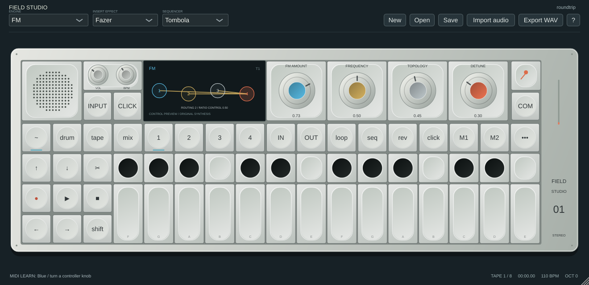

# MIDI learn: Faderfox, Arturia BeatStep and other controllers

Connect the controller by USB, or connect its MIDI output through a MIDI interface. In the standalone, enable its input in **Options → Audio/MIDI Settings**. In a DAW, route the controller to the OPVYN instrument track and enable monitoring/record arm as required by that DAW. Under **COM → MIDI routing & clock**, leave input channel at Omni to start, and enable **Receive other channel messages**. Notes/sustain must be enabled to play pads or keys.

## Map a knob or fader

1. Right-click an on-screen knob. Choose **Learn Absolute CC (pickup / no jump)** for an ordinary potentiometer/fader, or the appropriate relative mode for an endless encoder.
2. Turn the hardware control. The first eligible CC captures its number and channel without changing the sound. The status bar shows the assignment.
3. Move the control again. Pickup waits until an absolute control reaches or crosses the software value; this prevents sudden jumps. If mouse/host automation changes that value, pickup re-arms. Choose **jump** if immediate changes are wanted.
4. Right-click again to inspect/remove the assignment or learn with reversed direction.

**COM → MIDI learn / controller mappings** lists all assignable destinations, including parameters without a visible knob, four tracks' levels/pans/mutes/solos, selected sampler/DBox pad controls, tape play/stop/rewind/seek and loop boundaries. Mixer and drum-pad knob right-clicks target their actual controls. Pad-specific mappings follow the currently selected pad. Synth parameter mappings remain assigned to the parameter, not whichever page is currently visible. Disabled controls cannot be clicked, but their parameters remain listed in COM.

Assignments are embedded in `.field` projects and DAW host state. **Save controller profile…** exports a `.field-midi` XML file; **Load controller profile…** replaces the current assignments after validation. Reuse a profile with another project. Starting a new project clears assignments. Cancel MIDI learn if you change your mind. A missing/corrupt profile does not silently replace the current mappings.

Example 16-control layouts are included under `presets/controllers` in source and `Controller profiles/controllers` in downloads. They require configuring your hardware for CC20–35 on channel 16; they do not change hardware settings automatically.

## Encoder modes

| Mode | Increase | Decrease | Neutral |
|---|---|---|---|
| Two's complement | 1–63 | 65–127 (value − 128) | 0, 64 |
| Offset 64 | 65–127 | 0–63 (value − 64) | 64 |
| Sign/magnitude | 1–63 | 65–127 (64 − value) | 0, 64 |

Each relative unit moves 1/127 of the destination's normalized range. Steps accumulate for stepped/choice parameters. Hardware acceleration sends larger deltas. **Reversed direction** supports controllers whose increment/decrement polarity is opposite. Confirm direction at low volume before performing.

The [Faderfox EC4 manual](https://www.faderfox.de/PDF/EC4%20Manual%20V03.pdf) documents absolute and relative CC modes as well as NRPN and other commands. Choose a **7-bit CC** mode for this beta. If clockwise decreases the value, use the reversed learn option. The project owner reports a connected Faderfox with successfully assigned controls (1 November 2026); the model and encoder mode were not specified. This does not specifically validate the EC4 or its factory setup.

The [Arturia BeatStep documentation](https://www.arturia.com/products/hybrid-synths/beatstep/resources) includes its MIDI Control Center configuration. Configure encoders for absolute CC for an initial test, learn them individually, and configure pads as notes to play sounds. OPVYN also accepts MIDI clock/Start/Stop; select **Receive MIDI clock** to follow incoming clock, or let the DAW supply tempo/transport when using the plugin. Avoid running both its sequencer and OPVYN's sequencer unintentionally.

## User testing — 1 November 2026

The project owner reports successful plugin operation and DAW automation, successful Faderfox connection/control assignment, and working Arturia BeatStep use. DAW, OS, Faderfox model and exact modes were not supplied. This records hands-on success for that setup without claiming every host, controller mode, clock feature or pad/encoder configuration was tested.

## Scope and limits

- Learned CCs take precedence over their legacy documented CC destination. Removing the mapping restores legacy behavior. One CC can intentionally map to several destinations.
- Mappings identify **channel + CC**, not the physical USB device. The plugin sees MIDI routed/merged by its host; the standalone wrapper also merges enabled inputs. Give controllers different MIDI channels if they reuse CC numbers, or route only the required device. Ports are selected in the standalone/DAW, not in a mapping file.
- Input channel/message filters apply before learning. CC64 and channel-mode CC120–127 are reserved for sustain/reset safety and are not learnable.
- CC feedback/automatic LED rings, device handshakes, NRPN, 14-bit CC, pitch-bend learn, aftertouch/MPE learn and manufacturer SysEx are not implemented. Existing note input and the fixed pitch-bend route still work.
- Recording and tape edits use the prepared background job path. They are not sample-accurate; busy/rejected jobs appear in the status bar. Project loading and file operations remain outside MIDI learn.

## Tempo and MIDI clock

The metronome-shaped button opens the tempo/sync page. Use Beat Match to send standard clock to compatible gear, Receive to follow it, or Shift-ochre to relay a received stream to the selected MIDI output. Tap BPM / T sets tempo; arrows nudge (Shift: 0.01 BPM). The tape link, relay and click-sound parameters are automatable and available in the MIDI mapping target list. See [setup, routing and limits](TEMPO_SYNC.md). Clock support depends on the device and host; this does not claim new hands-on BeatStep clock validation.

## Recording and timeline control (0.4.1)

Right-click the panel Record, Play, Stop, Lift, Drop, Split, Back, Forward, IN, OUT or Loop button to assign a CC. Other actions are under **COM → MIDI learn / controller mappings**. These are software controller extensions, not additional manufacturer CC assignments.

| Destination | Behaviour |
|---|---|
| Tape record / finish recording | Press once to prepare/start recording; release and press again to finish. Count-in, record level/pan and tape speed are separately learnable parameters. |
| Tape play / stop / rewind | Play starts playback; Stop finishes recording, stops playback and releases tape tricks. Rewind returns to zero. |
| Tape selected track | Absolute 0–127 selects tracks 1–4. Selecting another track finishes recording. |
| Tape seek / fine jog | Seek spans six minutes. Assign **fine jog** to a relative encoder: one relative tick moves approximately 15.75 ms. |
| Back / forward; previous / next bar; recorded end | Move one second, one bar at the effective tape tempo, or to the end of recorded audio. |
| Loop start / end; set loop in / out; toggle loop | Absolute boundary controls or button actions at the playhead. |
| Copy, lift, drop, split, join, merge, bounce, clear selection, undo, redo, slide backward/forward | Use the existing tape selection and edit-track mask. Clear and lift alter audio; assign dedicated buttons. Slides move one beat. |
| Sample capture input / output / finish | Prepare capture from the selected input or resample the main output, then finalize the sample. Source selection remains under the sampling page. |
| Tape brake / reverse / roll | Momentary: send 127 while pressed and 0 when released. |
| Metronome enabled | 127 enables, 0 disables; click level and sound are separate parameters. |

The included `Tape-recording-16.field-midi` profile provides a ready-to-configure 14-button, track-selector and jog layout on channel 16 / CC20–35; see `presets/controllers/README.md` for the order. Loading a profile replaces existing assignments.

Configure action buttons to send **CC 127 on press and CC 0 on release**, using Absolute CC. New action destinations ignore pickup and trigger only on the rising edge, so repeated high values do not repeat edits. MIDI learn consumes its first message; release and press again to perform the action. Use relative modes for fine jog, not action buttons. Existing mappings remain compatible and all new assignments save in projects, host state and controller profiles.

Heavy recording/capture/edit actions cross a bounded queue to the control thread and then use the existing background preparation path. They execute against the selection current when the command is serviced. Stop/Panic or project replacement invalidates queued old actions. Stop also cancels pending recording preparation; a full action queue cannot prevent stopping. When another media operation is busy, retry after it finishes; do not use rapid edit macros as a batch script. Sample-capture finish is separate from tape Stop. Host-follow transport can override manual transport changes.
