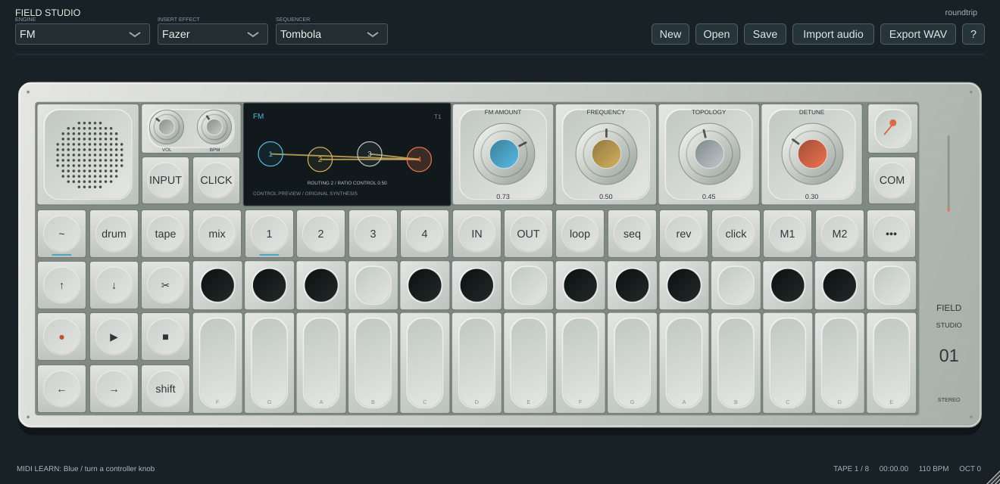

# MIDI learn: Faderfox, Arturia BeatStep and other controllers

Connect the controller by USB, or connect its MIDI output through a MIDI interface. In the standalone, enable its input in **Options → Audio/MIDI Settings**. In a DAW, route the controller to the Field Studio instrument track and enable monitoring/record arm as required by that DAW. Under **COM → MIDI routing & clock**, leave input channel at Omni to start, and enable **Receive other channel messages**. Notes/sustain must be enabled to play pads or keys.

## Map a knob or fader

1. Right-click an on-screen knob. Choose **Learn Absolute CC (pickup / no jump)** for an ordinary potentiometer/fader, or the appropriate relative mode for an endless encoder.
2. Turn the hardware control. The first eligible CC captures its number and channel without changing the sound. The status bar shows the assignment.
3. Move the control again. Pickup waits until an absolute control reaches or crosses the software value; this prevents sudden jumps. If mouse/host automation changes that value, pickup re-arms. Choose **jump** if immediate changes are wanted.
4. Right-click again to inspect/remove the assignment or learn with reversed direction.

**COM → MIDI learn / controller mappings** lists all assignable destinations, including parameters without a visible knob, four tracks' levels/pans/mutes/solos, selected sampler/DBox pad controls, tape play/stop/rewind/seek and loop boundaries. Mixer and drum-pad knob right-clicks target their actual controls. Pad-specific mappings follow the currently selected pad. Synth parameter mappings remain assigned to the parameter, not whichever page is currently visible. Disabled controls cannot be clicked, but their parameters remain listed in COM.

Assignments are embedded in `.field` projects and DAW host state. **Save controller profile…** exports a `.field-midi` XML file; **Load controller profile…** replaces the current assignments after validation. Reuse a profile with another project. Starting a new project clears assignments. Cancel MIDI learn if you change your mind. A missing/corrupt profile does not silently replace the current mappings.

Example 16-control layouts are included under `presets/controllers` in source and `Controller profiles/controllers` in downloads. They require configuring your hardware for CC20–35 on channel 16; they do not change hardware settings automatically.

## Encoder modes

| Mode | Increase | Decrease | Neutral |
|---|---|---|---|
| Two's complement | 1–63 | 65–127 (value − 128) | 0, 64 |
| Offset 64 | 65–127 | 0–63 (value − 64) | 64 |
| Sign/magnitude | 1–63 | 65–127 (64 − value) | 0, 64 |

Each relative unit moves 1/127 of the destination's normalized range. Steps accumulate for stepped/choice parameters. Hardware acceleration sends larger deltas. **Reversed direction** supports controllers whose increment/decrement polarity is opposite. Confirm direction at low volume before performing.

The [Faderfox EC4 manual](https://www.faderfox.de/PDF/EC4%20Manual%20V03.pdf) documents absolute and relative CC modes as well as NRPN and other commands. Choose a **7-bit CC** mode for this beta. If clockwise decreases the value, use the reversed learn option. We have not physically tested an EC4 or other Faderfox model; do not assume its factory setup matches a particular encoder mode.

The [Arturia BeatStep documentation](https://www.arturia.com/products/hybrid-synths/beatstep/resources) includes its MIDI Control Center configuration. Configure encoders for absolute CC for an initial test, learn them individually, and configure pads as notes to play sounds. Field Studio also accepts MIDI clock/Start/Stop; select **Receive MIDI clock** to follow incoming clock, or let the DAW supply tempo/transport when using the plugin. Avoid running both its sequencer and Field Studio's sequencer unintentionally.

## Scope and limits

- Learned CCs take precedence over their legacy documented CC destination. Removing the mapping restores legacy behavior. One CC can intentionally map to several destinations.
- Mappings identify **channel + CC**, not the physical USB device. The plugin sees MIDI routed/merged by its host; the standalone wrapper also merges enabled inputs. Give controllers different MIDI channels if they reuse CC numbers, or route only the required device. Ports are selected in the standalone/DAW, not in a mapping file.
- Input channel/message filters apply before learning. CC64 and channel-mode CC120–127 are reserved for sustain/reset safety and are not learnable.
- CC feedback/automatic LED rings, device handshakes, NRPN, 14-bit CC, pitch-bend learn, aftertouch/MPE learn and manufacturer SysEx are not implemented. Existing note input and the fixed pitch-bend route still work.
- Destructive tape editing, record arming, project loading and file operations are not controller-learn destinations. They still require the remaining prepared-job ownership work. Live continuity limitations are documented in AUDIO_REWRITE_PROGRESS.md.

