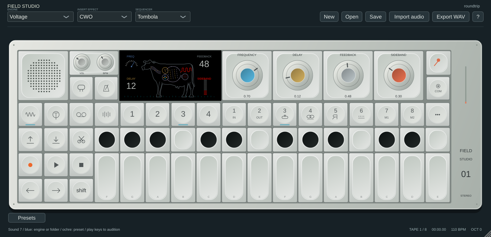

# CWO: screen and software effect

The screen follows the supplied guide image: an original vector cow silhouette with an internal signal diagram, blue frequency gauge, ochre delay readout, grey feedback readout, red sideband meter and teal bottom ticks. Insert CWO and mixer/master CWO use the full LCD. Readouts from 0–99 indicate normalized control positions, not hardware-calibrated milliseconds, Hz or feedback gain. The diagram is a control illustration, not an audio analyzer. See [the motion/behaviour research](research/EFFECT_VISUAL_MOTION.md) for firsthand observations and remaining parity gaps.

Teenage Engineering's [original OP-1 reference](https://teenage.engineering/guides/op-1/original/reference) describes CWO as a pitch-shifting delay and lists frequency, delay, feedback and sideband; the [field guide](https://assets.teenage.engineering/_img/69f248938d433104c4dd1846_original.pdf) shows those same four labels and the cow screen. These sources do not establish the internal algorithm or a phase-vocoder implementation. Field Studio uses its own analytic frequency shifter and feedback delay, not recovered firmware DSP.

## Four controls

| Encoder | Software behaviour |
|---|---|
| Blue | Frequency shift: `0.02 + blue³ × min(2000, sampleRate × 0.2)` Hz. Low settings give slow motion/beating; higher settings give metallic frequency offsets. Shift provides finer mouse dragging on all four encoders. |
| Ochre | Fractional delay: one sample plus `ochre² × 800` ms. Changes are smoothed over approximately 5 ms. |
| Grey | Echo feedback: `grey × 0.94`. Shifted output returns into the delay, so subsequent repeats accumulate frequency shifts. Increasing Feedback also introduces original audio (`dry × grey × 0.5`), matching the demonstrated interaction qualitatively; that gain curve is unmeasured. |
| Orange | Sideband blend: downshifted at zero, both shifted bands at midpoint, upshifted at one. Shift fine-adjusts Sideband; it does not replace it with a mix control. |

The sideband stage uses a 65-tap windowed FIR Hilbert transform, with a 32-sample group delay on both sideband paths. This is additive frequency shifting: a 1 kHz tone with a 200 Hz setting produces an 800 Hz lower band and a 1.2 kHz upper band, blended by Sideband. It is not a pitch-ratio change that preserves musical intervals. The finite-length filter has limited low-frequency quadrature accuracy and cannot establish hardware sideband rejection or sound equivalence. As with other digital frequency shifters, material near Nyquist can alias.

The shifter uses fixed-size arrays and precomputes coefficients during preparation. The audio callback does not allocate/free heap storage for CWO. The feedback path has soft saturation; the prior generic tone/stereo controls no longer override CWO feedback/sideband. The host's current-setting tail estimate includes insert and master CWO echo decays instead of always reporting four seconds. Automation/modulation can change the subsequent decay.

**Blend override:** selecting CWO in the UI and importing an active native CWO patch sets full module output. COM → Effect wet/dry override remains an optional software extension, independent of the four native roles. Existing project/slot blend settings are preserved.

**Compatibility:** existing project, patch and MIDI parameter IDs and stored knob positions are retained, but saved CWO sounds can change audibly because the four controls now drive their documented roles. No hardware parameter law or exact sound parity is claimed.

## Implementation checks

Core tests inject a 1 kHz tone at 8 kHz sample rate and verify a +200 Hz upper sideband dominates both carrier and opposite sideband by at least 100:1 in power. Another delay setting retains that shift frequency. The lower endpoint suppresses upper/carrier energy; midpoint contains both bands with similar power. Feedback introduces measurable carrier energy. Impulse tests verify independent delay timing, FIR latency and feedback repeats; equal stereo inputs remain equal. Maximum delay/feedback/sideband settings remain finite/bounded, and callback allocation/free guards cover the test renders. These are synthetic implementation checks, not microphone, hardware or commercial-DAW validation.

Native editor checks cover insert/master screens and minimum/maximum controls, preserve the correct MIDI-learning targets for fine frequency and sideband, and verify the Shift drag sensitivity. Host-state tests check a long CWO tail and serial insert/master tail accounting. Native screenshots are in `docs/screenshots/cwo-*.png`.
