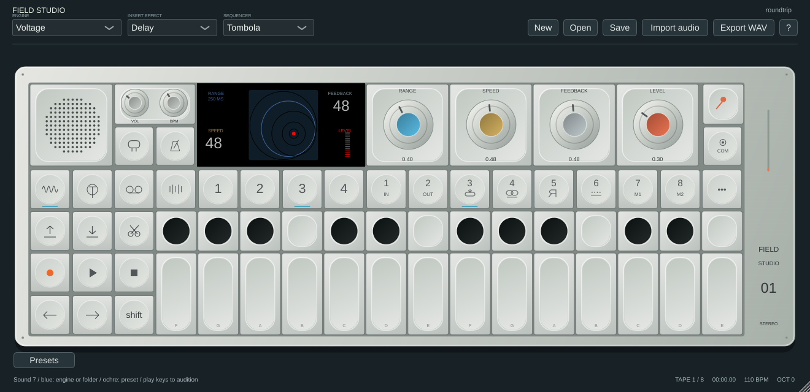

# Panel legends and Delay

The supplied hardware photograph is the reference for the printed function-row legends. All eight sound keys now retain a number **and** a secondary marking: IN, OUT, loop arrow, sequencer/infinity symbol, reversed R, click/dots, M1 and M2. These are vector drawings, so glyphs do not depend on Unicode font coverage. Synth, drum, tape and mixer mode keys also use their corresponding drawn symbols; transport and input/click/COM controls have dedicated vector legends.

The artwork is permanent while actions remain contextual: in Synth/Drum, keys 1–8 recall/browse/save sound slots; in Tape/Mixer/Sequencer, the secondary functions continue to apply. Existing click, Shift, hold-to-save and MIDI behaviour is retained. Tooltips describe the current mode. Count-in and sample-capture transport buttons retain their dynamic ARM/SAMPLE text.

Delay now follows the supplied LCD image: range at top left, speed below it, feedback at top right, a red level meter, and overlapping circles in a dark blue square. Insert and master Delay use the full screen. The animated circles are a control illustration, not measured audio output.

## Software controls

| Encoder | Behaviour |
|---|---|
| Blue / Range | Chooses a base range from 62.5, 125, 250, 500, 750 or 1000 ms. |
| Ochre / Speed | Changes delay time relative to that range: `range × 2^((0.5 − speed) × 2)`. Faster settings shorten repeats; midpoint gives the base range. |
| Grey / Feedback | Sets cross-channel echo-loop feedback, up to 0.94. |
| Orange / Level | Scales wet echo output from silence to full level, independently of feedback. Shift + orange controls the overall wet/dry mix. |

Delay-time changes use approximately 5 ms smoothing. The existing two-second-capable buffer is reused without callback allocations. The host tail estimate includes these feedback echoes for both insert and master effects. Existing stored knob positions and parameter IDs remain compatible, but previous Delay presets can sound different: the old model used these controls for coupled delay/feedback and generic tone/stereo width.

These ranges and mappings are original software choices, not verified hardware parameter laws. The artwork follows the supplied references without establishing pixel or sound parity.

## Checks

Core impulse tests verify 250 ms at midpoint speed, 125 ms at maximum speed, 500 ms in a wider range, independent feedback repeats, level-zero wet silence and finite/bounded maximum controls. The callback allocation/free guard covers those renders. Existing full plugin/core tests still run, including DBox feeding Delay. Native screenshots cover synth/tape panel legends and insert/master Delay, with the reference example displaying RANGE 250 MS, SPEED 48 and FEEDBACK 48.
