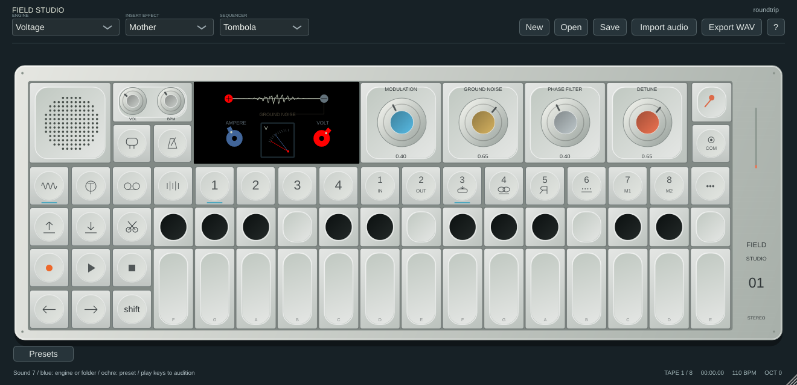
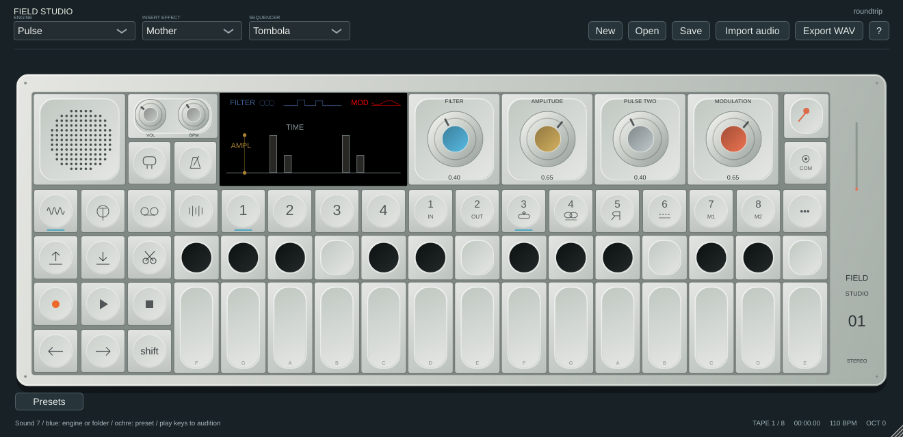
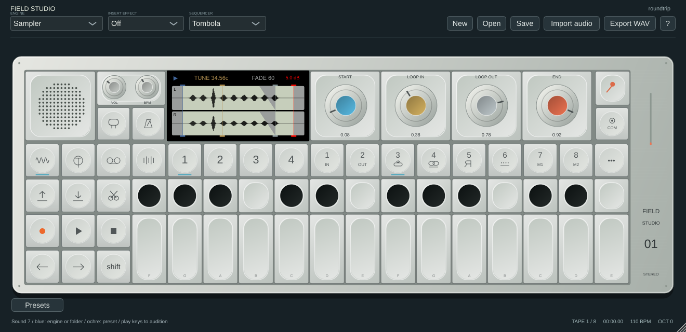
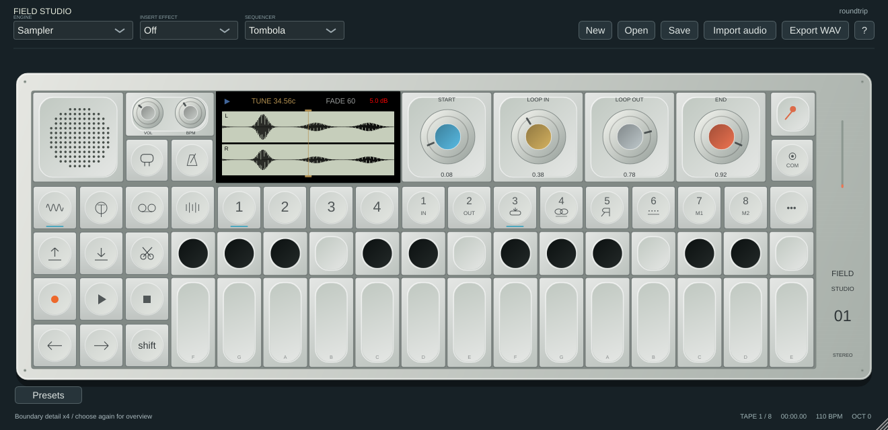

# String, Voltage, Pulse and Sampler

The supplied stills and [official field guide, pages 16–19](https://assets.teenage.engineering/_img/69f248938d433104c4dd1846_original.pdf) establish layouts and encoder roles. These screens use original vector drawing and software DSP. No hardware sound, font, artwork or animation equivalence is claimed.

## Synth screens and controls

- **String:** blue Tension changes waveguide weighting; ochre Decay controls feedback damping; grey Detune changes the stereo read offset; orange selects one of four original excitation types (noise, filtered noise, short burst, tonal/noise). The coloured string profiles, rail and markers respond to controls. The stereo detune is not an independent pair of physical strings; range, pitch/decay laws and impulse types are uncalibrated.
- **Voltage:** blue Modulation changes phase modulation; ochre adds Ground Noise; grey controls an original all-pass Phase Filter; orange controls oscillator Detune. Dials/wire illustration follow controls; the red meter uses actual main output peak, not a measured electrical voltage or an isolated synth signal. The wire waveform is an illustration, not an oscilloscope.
- **Pulse:** blue controls filtering, ochre Amplitude scales the oscillator (zero is silent), grey adds the Second Pulse, orange adds phase Modulation. The amplitude/pulse drawing and modulation display follow controls; they are not sampled audio traces.

These changes correct roles previously shared with generic synth handling. Existing sounds and automation keep their parameter IDs but can sound different. Precise hardware topology, parameter curves, dynamic animation and factory preset equivalence remain open.

## Melodic Sampler

Normal blue/ochre/grey/orange edit Start / Loop In / Loop Out / End. Coloured waveform markers remain draggable. The full LCD displays actual cached L/R source waveform previews and a crossfade wedge. Preview sampling is bounded and can miss narrow transients; it is not sample-exact zero-crossing editing. The drum sampler retains its pad controls and previous screen.

Hold or latch Shift:

| Encoder | Control | Software range |
|---|---|---|
| Blue | Direction | Forward / reverse |
| Ochre | Fine Tune | −1 to +1 semitone (−100 to +100 cents) |
| Grey | Loop Fade | 0–1; overlap up to half the loop span |
| Orange | Gain | 0–2; unity at 1, approximately +6 dB at 2 |

The LCD shows tuning in cents and gain in dB; the fine-tune encoder/host parameter uses semitones. All three new controls support automation and MIDI learn and persist in DAW state, `.field` projects and sound snapshots/presets. Old projects default to fine tune 0, fade 0 and gain 1; imports/captures reset them to those neutral values. This pass does not translate additional native OP-1 fine/fade/gain metadata or establish its hardware transfer laws.

Fine tune, gain, fade and direction affect active melodic voices. Start/end/loop bounds and loop enable are still captured when a voice starts: retrigger after editing these for the new region. Loop fade blends the end into the start (or the inverse for reverse playback), skips the already blended overlap and therefore shortens the steady loop period. Fade is active only for held, looping melodic samples. Existing ADSR and note-release rules remain. This is an original crossfade law, not a recovered hardware implementation.

For marker zoom, right-click a normal marker encoder and select **Zoom around this sample marker / overview**, or click the corresponding quarter of the LCD header (Start, Loop In, Loop Out, End). Select the same boundary again for overview. Double-click the waveform retains the existing four-times zoom; double-click a knob still resets its parameter. Shift returns to the entire waveform. Hardware encoder-press gestures and its extra finer-tune gesture are not reproduced exactly.

## Validation

Native screenshots were inspected. Tests exercise independent audio changes for all four controls on each synth, Pulse amplitude zero, sampler pitch increase, gain scaling/mute, reduced loop-wrap discontinuities in both directions, callback allocation/free guards, marker zoom toggling, Shift targets and host-state restoration. All eight local suites and three core ASan/UBSan suites are release gates alongside Windows/macOS/Linux builds. Exact hardware/DAW coverage remains as described in the README and parity ledger.

