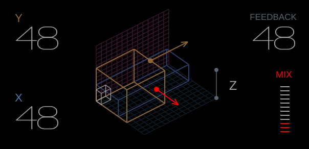
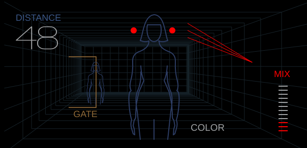
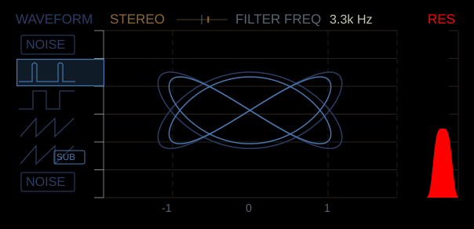
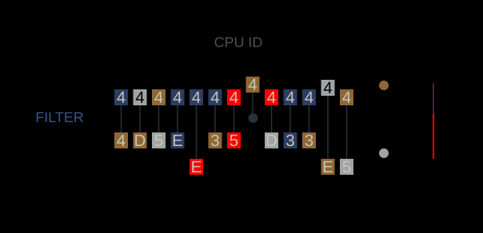

# Grid, Mother, Dimension and DNA LCD fidelity

This pass uses the supplied guide screenshots to compare LCD content at a 604 × 292 reference canvas, independently of the surrounding desktop UI. Renderers use original vector paths and parameter-driven graphics; supplied screenshot bitmaps and manufacturer fonts are not bundled. The native integration harness can export full app screenshots and `lcd-grid`, `lcd-mother`, `lcd-dimension` and `lcd-dna` images for inspection.

## What changed

| Screen | Reference-based changes | Behaviour retained |
|---|---|---|
| Grid | Isometric floor and upright wall grids, blue wire frame, ochre size box, white origin cube, arrow endpoints, Z marker, thin-stroke values and 12-segment Mix meter. | X/Y resize the ochre geometry; feedback changes its height/red vector; Mix changes the red meter segments. Patch/master values remain independent. |
| Mother | Finite rear-wall perspective, denser tunnel frames, large foreground/rear figure, gate bracket, colour rays, control dots and matching positions for Distance/Gate/Color/Mix. | Distance changes foreground depth, Gate changes the bracket, Colour changes ray geometry and Mix updates the meter. No invented free-running room animation. |
| Dimension | Paired 2:3 Lissajous knot in place of four ellipses, corrected plot centre/extents, colours, left waveform selection, plot axes, SUB badge and rounded resonance peak. | Stereo changes trace size, waveform changes selection/trace phase, cutoff shows this engine's frequency, and resonance changes the peak. Trace motion remains a control illustration. |
| DNA | Dedicated linked hexadecimal-tile display with raised/lowered branches, CPU ID caption, Filter label, terminal dots and purple/red noise strip. | Wave number/modifier vary the deterministic tile illustration and nodes; filter changes its blue indicator and Noise the red strip. It is not a live spectrum or CPU serial display. |

## Native LCD details

## Limits of the comparison

The supplied images show particular hardware states without all normalized control values or animation frames. They support static layout and linework comparisons, not a claim that every parameter state or moving frame is identical. Native snapshots were inspected side by side at the reference size. They are not an automated hardware pixel-parity oracle.

Numeric shapes are original single-stroke paths. Labels and hexadecimal tiles still use JUCE/platform text, so manufacturer typography and antialiasing are not exact. Dimension deliberately shows the actual independent engine cutoff; it does not display the guide's example `440–1440` range without implementing and measuring that hardware law. DNA's CPU ID caption follows the guide artwork but does not read or expose a machine's unique identifier. Its characters are a deterministic parameter illustration.

These changes do not alter synth/effect DSP, parameter IDs, MIDI mapping or project formats. Exact sonic equivalence and remaining engine/control differences are tracked separately in [the parity ledger](PARITY.md). [Spatial control guide](MASTER_SPATIAL.md) and [screen validation](SCREENS.md).
