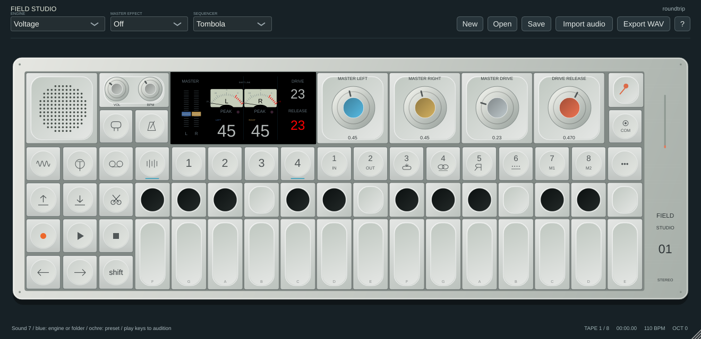
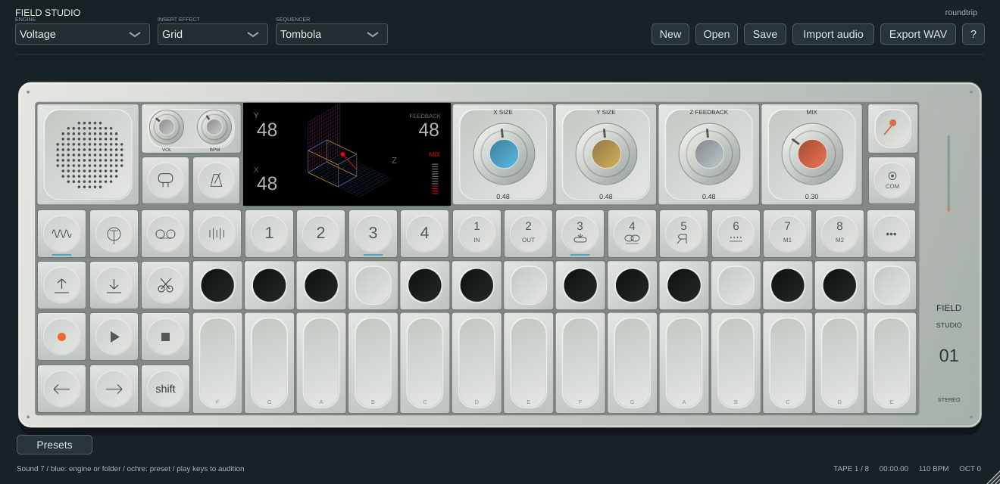
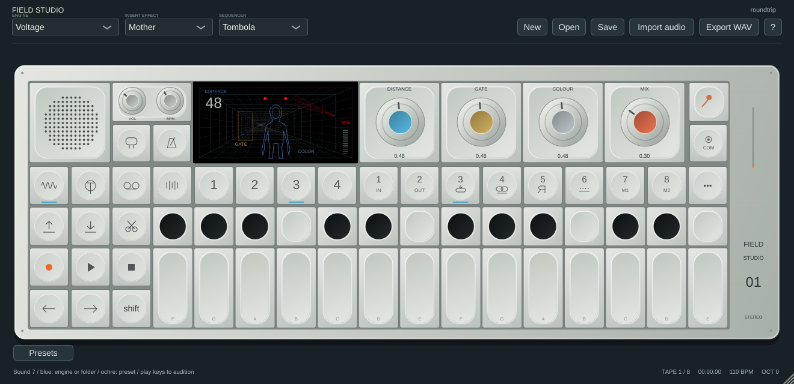

# Master Out, Grid and Mother

This pass follows the supplied guide stills and the [official field guide](https://assets.teenage.engineering/_img/69f248938d433104c4dd1846_original.pdf), especially Master Out on page 44. Artwork and DSP are original implementations, not extracted firmware or a hardware equivalence claim.

## Master Out — mixer T4

Blue controls Left, ochre Right, grey Drive and orange Release. Hold/latch Shift while dragging either of the first two software encoders to set both levels to the same value. The Shift link gesture is UI-only: DAW automation and learned left/right MIDI targets remain independent. Exact hardware link balance/gesture rules are unverified.

Two meters read the final stereo block, including Album playback when active. PEAK indicators read each channel's post-makeup, pre-saturation master signal at or above unity; they are not calibrated hardware overload detectors and do not latch. A brief event between UI refreshes may be missed. Numeric level/Drive/Release readouts are 0–99 normalized software positions; Release uses the existing 5 ms–2 s range, not a recovered hardware law. The software encoders retain their actual stored gain/seconds readouts.

Drive keeps the existing compressor parameter ID. It now combines envelope-based gain reduction, `1 + 3 × Drive` makeup and a continuous saturation blend; Release controls envelope decay. The separate EQ Shift-orange saturation extension is retained. Transfer curves, thresholds, timing, smoothing and meter ballistics are not hardware calibrated. Existing nonzero Drive automation/projects can sound louder or more distorted than beta 2.

## Grid

Blue X and ochre Y independently control the two delay dimensions; grey Z controls cross-feedback; orange controls dry/wet Mix. The screen's original 3D construction changes with X/Y/Z and shows Mix separately. The DSP uses bounded cross-feedback taps at original software times; it is not a reconstruction of the manufacturer's topology. Host tail estimates now include the high-feedback Grid decay.

## Mother

Blue Distance controls room-tap spacing. Ochre Gate controls how long returns remain open after input drops below the software threshold, with a short closing fade. Grey Colour controls return filtering. Orange controls dry/wet Mix. The room/person depth, rear gate frame and colour rays respond to those controls; held settings do not invent free-running motion. This is an original gated-room model, not measured hardware acoustics or recovered reverb DSP.

## Blends and compatibility

Grid/Mother no longer repurpose Z/Colour as the shared generic tone control or orange as stereo width. Normal orange is their native Mix; Shift-orange retains the separate overall blend extension. Selecting either effect in the UI and importing an active native patch use overall blend 100%, so native Mix is applied once. Existing project/slot blends remain stored; set COM → Effect wet/dry override to 100% if you want the full native Mix range. Earlier saved sounds can change. Patch/master versions use the same renderer and DSP but independent parameters.

## Validation

Eight local suites cover screenshots, linked UI level changes, separate stereo meter values, audible Drive gain/release behaviour, spatial control isolation, dry Mix endpoints, native import Mix mapping and allocation-free/bounded spatial processing. Core ASan/UBSan and all three platform release builds gate publication. The screenshot stills do not establish animation timing or pixel-perfect parity. User-reported plugin/automation/controller success remains separate from these automated checks.

