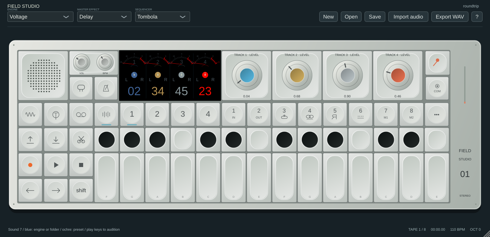
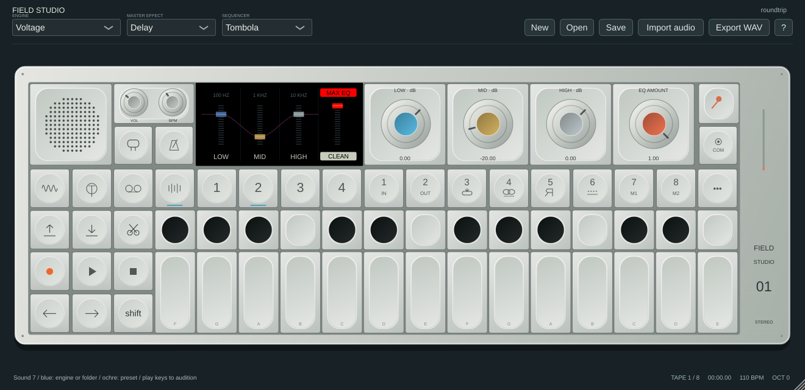

# Mixer and EQ reference pass

Based on the supplied mixer/EQ stills and the [official field guide](https://teenage.engineering/guides/op-1), mixer T1 and EQ T2 now occupy the full LCD. Artwork is original vector rendering; hardware fonts/assets are not included.

## Mixer

Four columns have meter scales/needles, pan pointers, track numbers and coloured level readouts. Levels display 0–100 for the existing software 0–2 gain range (50 is unity), not a measured hardware mapping. Needles show post-level/pan/mute tape peaks from the latest engine render segment, before tape colour/master processing, with UI decay. They are not calibrated VU meters and may miss peaks in earlier MIDI-separated segments. Silent/stopped/muted tracks do not receive invented activity.

Normal encoders edit levels; Shift edits pans. Shift + T1–T4 mutes the corresponding track while on the T1 mixer page. Click any channel to mute it; Shift-click to toggle the software solo extension. Normal T1–T4 still selects mixer/EQ/master FX/master output pages.

## EQ

Blue/ochre/grey edit existing low/mid/high gains. Orange edits EQ Amount (0–1), scaling active band gains in dB. Click a band column to enable/bypass that band without losing its gain. Click the middle of the red column to bypass the whole EQ. MAX EQ restores full Amount and overall enable; CLEAN sets Amount to zero while preserving band settings. These mouse commands are software counterparts of the reference controls; exact hardware press gestures and MAX/CLEAN state rules are unverified. Shift + orange retains the separate software saturation/drive control. Amount and four bypass flags are host parameters, MIDI-learn targets and project/memo state; old projects default to enabled/full amount.

The curve is a smoothed control illustration, not a measured spectrum or transfer function. Reference frequency labels are 100 Hz, 1 kHz and 10 kHz. The existing software split filters remain at 200/3500 Hz with gain range −24 to +12 dB; this pass does not establish hardware filter topology, cutoff/Q, smoothing or sonic parity. Existing drive remains independent of EQ bypass.

Local validation: eight application suites pass, including real audio checks for EQ Amount/bypass, host state restoration, per-track meter isolation/mute and Shift-track mute gestures. Native screenshots were inspected. The release workflow also gates publication on all three platforms and core ASan/UBSan.
