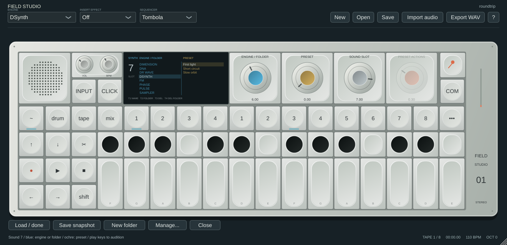
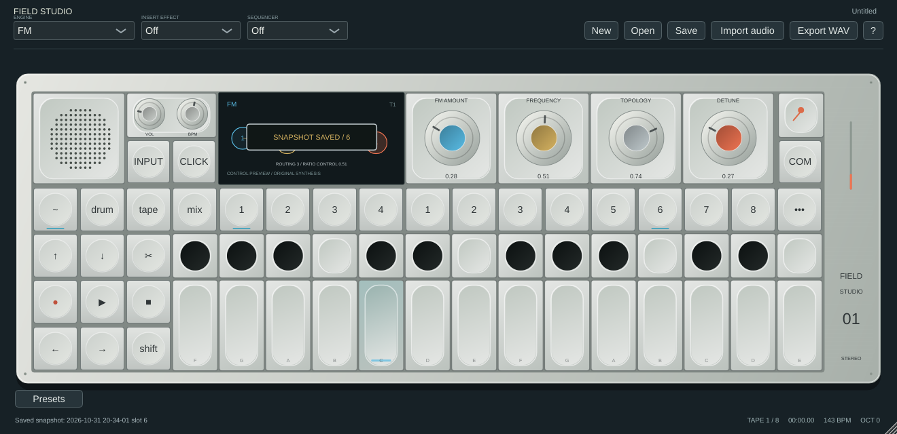

# Sound presets

The preset workflow follows the two supplied OP-1 field guide screenshots. Sound data and rendering are original Field Studio implementations; the manufacturer's factory sound bank is not included.

## Eight sound keys

In **Synth** or **Drum**, the eight keys to the right of T1–T4 show **1–8**. Each mode has its own eight slots. Click a sound key to recall its complete sound. Its tooltip shows the assigned preset name. The computer number keys also work: a short press recalls on release, so a long press can save the current edited sound without loading the slot's previous contents first.

A sound contains T1 engine/macros (including sample audio, regions and pad data where applicable), T2 envelope/play mode, T3 insert effect and T4 modulation/routing. Tempo, tape transport, sequencers, master mix and MIDI connection settings are not sound-preset parameters. The sixteen assigned slots travel with a project or host state.

In Tape/Mixer/Sequencer mode the keys retain their transport/memory functions.

## Browse and audition

**Shift + a sound key** opens the preset browser for that destination slot. The **Presets** button below the instrument opens the current slot.

- **Blue encoder:** synthesis engine or library folder.
- **Ochre encoder:** select and load a preset into the destination slot. Play the musical keys to audition it.
- **Grey encoder:** choose destination sound slot 1–8.
- Click an engine/folder or preset row to select it. The lists scroll around the selection.
- Left/right arrows navigate folders, up/down navigate and load sounds. **Enter / Load / done** loads and closes. **Escape / Close** closes the browser; the last loaded sound remains assigned.

Engine folders hold three original starter sounds per engine. Vocoder and Amp presets are labelled **(input)** because they need an audio source. Sampler starters include an original generated harmonic sample. SNAPSHOT and USER start empty. Custom user folders appear alongside them, with nested paths displayed using `>` separators. Synth and drum libraries are separate.

## Save a snapshot

Hold a sound key for **two seconds**. This captures the currently edited sound, assigns it to that key and writes a dated preset into **SNAPSHOT**. A screen overlay confirms the save. Releasing the held key does not reload the old sound. In the browser, **Save snapshot** does the same for its destination slot.

Snapshots survive New project, app restarts and project changes. Same-second snapshots get distinct file IDs, so they do not overwrite one another. **Shift + Drop**, outside the browser in Synth/Drum mode, randomizes the current sound; hold a sound key to keep a result. Clicking its key again recalls the saved version and discards unsaved parameter edits.

## User library management

Use **New folder**, or **Shift + T1** while browsing, to create a custom user folder inside the selected writable folder. From an engine folder, new folders go inside USER. **Manage…** exposes all operations; the hardware-style keys also work:

| Control | Action |
|---|---|
| T1 | Rename selected user preset |
| T2 | Rename a custom user folder |
| T3 | Delete selected user preset, after confirmation |
| T4 | Delete an empty custom user folder, after confirmation |
| Lift / Ctrl+C / Cmd+C | Copy the selected preset to the browser clipboard |
| Drop / Ctrl+V / Cmd+V | Paste a new independent preset in the selected writable folder |

Manage also provides preset **Copy to folder** / **Move to folder**, and **Copy folder into** / **Move folder into**. **Shift + Lift** (or Ctrl/Cmd+Shift+C) puts the selected folder on the clipboard; Drop pastes a folder copy into the selected destination. Folder copies get independent preset IDs, preserve nested/empty folders and appear only after staging succeeds. Folder moves retain the existing files. A folder cannot be put inside itself. Moving a preset writes the destination first, then deletes the source. Duplicate names are allowed and identified by independent IDs. A failed source deletion leaves the destination copy intact. Delete/rename of a library file does not remove sound data already assigned in a project.

Factory entries are read-only. Copy one to USER, SNAPSHOT or a custom folder before renaming it. The built-in SNAPSHOT and USER folders cannot themselves be renamed/deleted. Custom folders must be empty before deletion. Nested folders support up to eight levels, and scans admit at most 1024 custom folders. Folder transfers reject links, invalid presets and unrecognized files; transfers are limited to 512 MB.

**Manage → Show preset files** reveals the library, under JUCE's per-user application-data directory at `Field Studio/Presets/Synth` or `…/Drum`. Each `.fieldpreset` file is self-contained, including its sample data. Files can be backed up or copied into another machine's corresponding library folder. Refresh the browser by reopening it. Writes use a temporary file followed by destination replacement; IDs are UUIDs and name/path validation is shared across platforms.

## Boundaries and validation

This is a native Field Studio preset format, not hardware preset export. Existing OP-1 audio/preset imports still go through **Import audio**; see [PRESET_PARAMETERS.md](PRESET_PARAMETERS.md) for translation limits. Hardware sound equivalence, exact fonts/animations and the on-device text-entry gesture are not established. Rename/create use desktop text dialogs. Library scans, sample decoding and snapshot writes remain synchronous control operations, so very large sampled presets can briefly stall the interface.

Plugin integration tests exercise all 45 factory sounds for successful loading and finite output, independent synth/drum modes, all four sound modules, preserved global settings, snapshot reopen/new-project persistence, project/host slot round trips, folder create/rename/empty-only delete, independent copies, preset rename/delete, nested folder copy/move/rename, cycle/depth/collision/foreign-file rejection, factory protection, unsafe names and invalid-value rejection. Native editor tests exercise Shift-slot browsing, selection into a chosen slot, closing, two-second button holds and subsequent short-click recall. These are implementation checks, not hardware comparisons.
