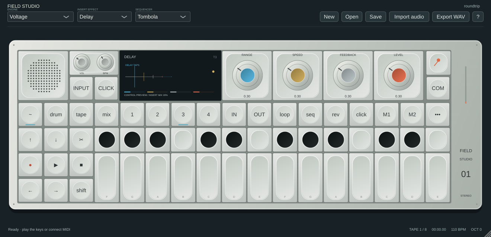
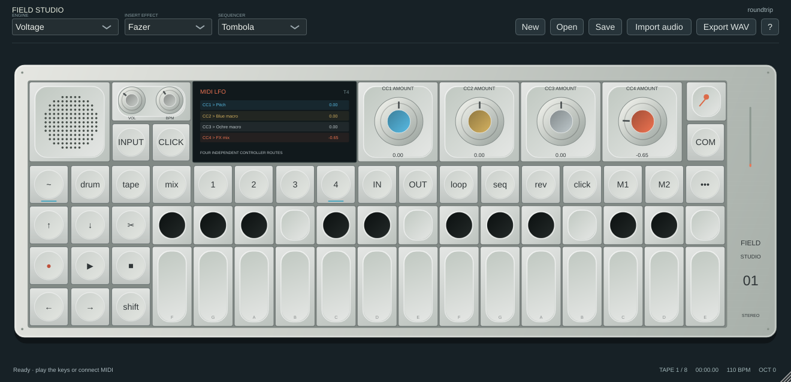

# Screen behaviour and validation

The interface remains an original, hardware-inspired rendering. Hardware-exact artwork, proportions, fonts and animation timing are not established; no manufacturer artwork is bundled.

## Current screen pass

- Disabled controls stay disabled across timer updates and render dimmed. This includes externally controlled tempo, synced LFO rate, unavailable manual Element input, Amp's continuous-input envelope controls, polyphonic glide and bypassed FX controls.
- The sampler shows bounded previews of actual left/right sample data, trim/loop markers, pad region, playback direction/mode and root information. Drag a marker to edit existing parameters. Double-click the waveform to toggle a four-times UI zoom; audio is unchanged by zooming. Preview sampling is bounded and can miss very narrow transients; it is not a sample-exact zero-crossing editor.
- Patch and master effects share original parameter-driven control illustrations, including an explicit bypass view. They use their own macros/mix values. Conceptual illustrations are labelled as previews rather than measured audio responses.
- Tremolo displays the selected shape and actual engine phase, with sync-division labels. MIDI shows four CC routing cards. Element/Random use sampled routed-modulation history; Value and Velocity have appropriate static control diagrams. Unsupported sensors/spectra are not represented as live input.
- Synth diagrams respond to their macro settings. Amp/Vocoder have parameter previews with actual output-level feedback rather than fabricated input meters. DBox uses its attack/gain/release/smooth transient shape.
- Tape count-in, recording/capture/album state, selected pads and held pads have distinct indicators. Tape controls remain available at the minimum window size.

## Checks performed

Six local CTest suites pass. The UI integration suite checks availability after five repeated refreshes, all15 engines on all four module pages, every patch/master FX, all six LFO sources with all six shape settings, and minimum1000×520 rendering. Native images were inspected at1320×640 and1000×520, including stereo sampler markers, tape controls, Delay, master Mother, the MIDI matrix and square-wave Tremolo. The suite generates optional PNG artifacts; it is not a hardware pixel-comparison oracle. Physical mouse/controller sessions and exhaustive visual/interaction regression remain open.

