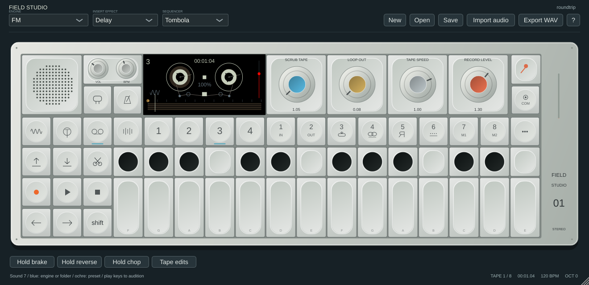
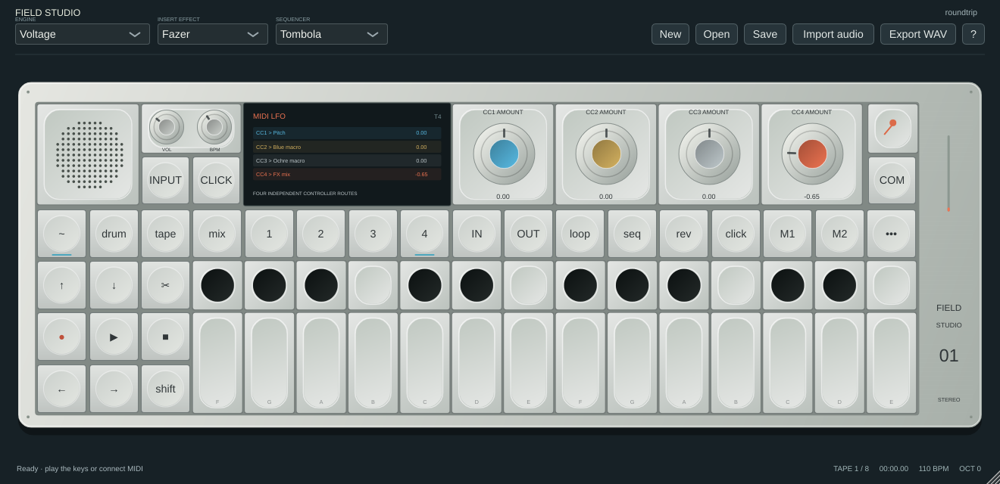
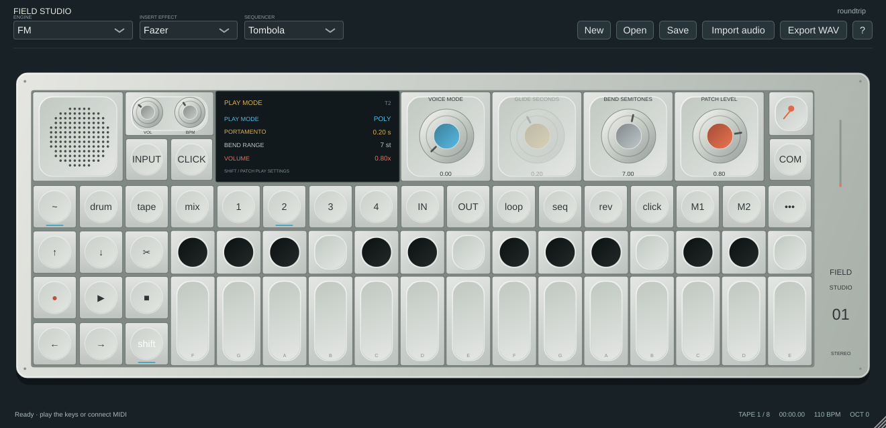

# Screen behaviour and validation

The interface remains an original, hardware-inspired rendering. Hardware-exact artwork, proportions, fonts and animation timing are not established; no manufacturer artwork is bundled.

## Current screen pass

- Disabled controls stay disabled across timer updates and render dimmed. This includes externally controlled tempo, synced LFO rate, unavailable manual Element input, Amp's continuous-input envelope controls, polyphonic glide and bypassed FX controls.
- The sampler shows bounded previews of actual left/right sample data, trim/loop markers, pad region, playback direction/mode and root information. Drag a marker to edit existing parameters. Double-click the waveform to toggle a four-times UI zoom; audio is unchanged by zooming. Preview sampling is bounded and can miss very narrow transients; it is not a sample-exact zero-crossing editor.
- Patch and master effects share original parameter-driven control illustrations, including an explicit bypass view. They use their own macros/mix values. Conceptual illustrations are labelled as previews rather than measured audio responses.
- Tremolo displays the selected shape and actual engine phase, with sync-division labels. MIDI shows four CC routing cards. Element/Random use sampled routed-modulation history; Value and Velocity have appropriate static control diagrams. Unsupported sensors/spectra are not represented as live input.
- Synth diagrams respond to their macro settings. Amp/Vocoder have parameter previews with actual output-level feedback rather than fabricated input meters. DBox uses its attack/gain/release/smooth transient shape.
- Tape count-in, recording/capture/album state, selected pads and held pads have distinct indicators. Tape controls remain available at the minimum window size.

## Checks performed

Eight local CTest suites cover the application. The UI integration suite checks availability after five repeated refreshes, all15 engines on all four module pages, every patch/master FX, all six LFO sources with all six shape settings, and minimum1000×520 rendering. Native images were inspected at1320×640 and1000×520, including stereo sampler markers, tape controls, Delay, master Mother, the MIDI matrix and square-wave Tremolo. The suite generates optional PNG artifacts; it is not a hardware pixel-comparison oracle. Physical mouse/controller sessions and exhaustive visual/interaction regression remain open.

## Official guide comparison, 31 October 2026

The supplied [official OP–1 field guide](https://teenage.engineering/guides/op-1) identifies itself as version 1.7.0. This is the same reference version retained in the research inventory. A fresh visual comparison of its envelope/play-mode illustration with the native screenshot identified a layout gap: our shifted envelope view collapsed settings into a large mode name plus a summary. It now shows the guide's four colored rows: play mode, portamento, bend range and volume. Values keep their real software units (seconds, semitones and gain), rather than inventing the hardware's parameter scale. Source artwork/fonts are not copied into the product.

Further guide-backed comparison remains necessary for the tuner, record-screen details, engine/effect illustrations, input/output/COM browsers and encoder click/hold gestures. Those are not declared complete by this one layout correction. The baseline guide/provenance and privately retained reference images remain in the sibling research workspace; the release only includes original product artwork.

Mixer T1 and EQ T2 now use the full reference-inspired LCD. Mixer needles read separate tape-track peaks; EQ has band and Amount controls with persistent bypass. See [mixer and EQ controls](MIXER_EQ.md) for meter/filter limits and native screenshots.

## Tempo LCD — beta 6

The tempo page has original vector Song/Play BPM panels, tape ratio/cm/s/IPS, clock/link colours, metronome illustration and level strip. MIDI wait/lock values come from the actual follower; the illustration animates at engine BPM while playing, rather than measuring click phase. See [tempo controls and screenshots](TEMPO_SYNC.md).

## Vocoder and sampling — beta 7

The Vocoder head/voice illustration uses actual input-level and analysis-envelope values, original vector outlines and parameter-driven wave/formant/band/mix readings. Sampling has Standby/Recording badges, real elapsed time, meter, threshold and selected source. Screenshots use generated signals through the native engine. [Controls and screenshots](VOCODER_SAMPLING.md).

## Grid, Mother, Dimension and DNA — beta 8

Grid and Mother use revised reference geometry and single-stroke numerical values. Dimension uses a paired 2:3 Lissajous preview, and DNA has a full tile-chain LCD. Native app and 604×292 LCD images are generated by the integration harness. [Fidelity notes, screenshots and remaining differences](LCD_FIDELITY.md).
