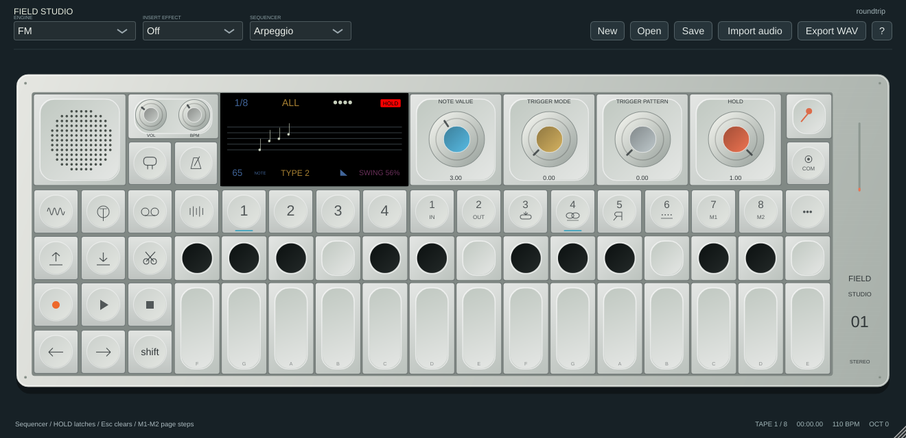
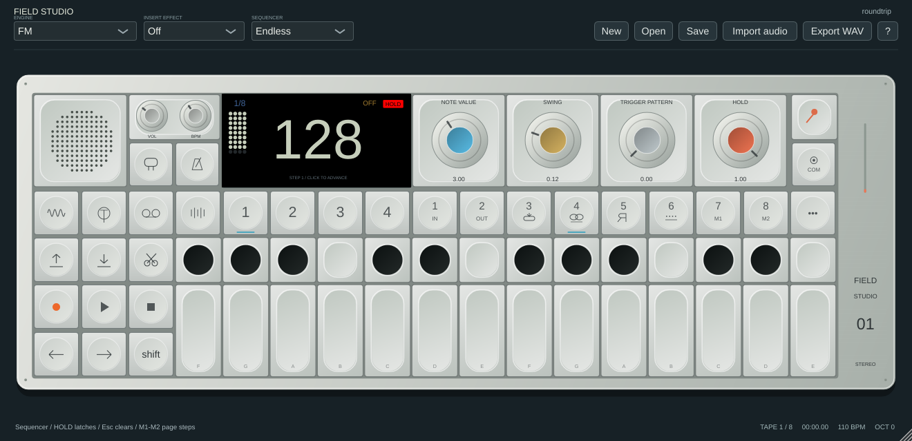
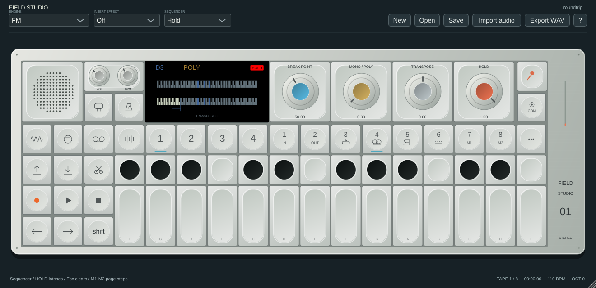
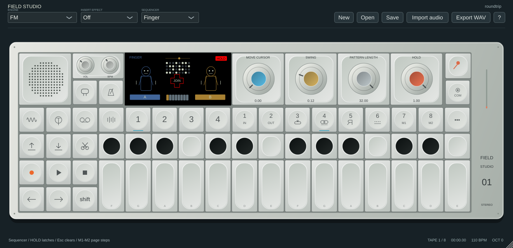

# Sequencer reference pass

The supplied Arpeggio, Endless, Hold, Pattern and Finger stills and the [official guide, pages 46–49](https://assets.teenage.engineering/_img/69f248938d433104c4dd1846_original.pdf) establish layouts and control names. The screens use original vector artwork, including original Finger performers/drum illustrations. Hardware artwork, fonts and executable algorithms are not included.

## Controls

| Mode | Normal blue / ochre / grey / orange | Shift |
|---|---|---|
| Arpeggio | Note value / trigger mode / trigger pattern / Hold | Note length / type / pause-skip / swing |
| Endless | Note value / swing / trigger pattern / Hold | Manual / unused / rotate / direction |
| Hold | Break point / mono-poly / transpose / latch | Same controls; Shift-click LCD HOLD clears held notes |
| Pattern | Cursor / swing / length / Hold | Erase / offset notes / move section / play mode |
| Finger | Cursor / swing / length / Hold | Erase / unused / unused / play mode |

Pattern length is MIDI-learnable through its encoder or COM mapping list. New host parameters retain existing IDs and append new ones. Pattern/Endless support up to 999 steps. Finger retains sixteen independent banks of up to 32 steps. Up to eight pitches per step are stored, played and saved with a common step velocity. Chord and step-velocity state round-trips through `.field` and DAW state; old single-note projects still load.

Arpeggio shows held notes on a staff. Endless shows the stored length and manual state. Hold shows its split and held-note keyboard. Pattern has a clickable pitch/time grid, and Finger has a 32-step dot matrix, A/B selection and JOIN. Reference-style visual proportions and animation are approximate, not a pixel-comparison result.

## Editing and playback

- Pattern: click a cell to add/remove its pitch; multiple pitches can share a step (maximum eight). Erase mode removes clicked pitches. The default viewport is MIDI60–72; keyboard octave changes move that viewport. Pitches outside it are retained but not drawn. M1/M2 page 16-step sections. The cursor encoder also pages through the buffer. Shift offset changes playback transpose rather than destructively rewriting notes.
- Endless: the same stored step buffer is used as Pattern. Program it through the Pattern grid or MCP, then choose Endless. In Manual mode, click the counter or use MCP manual_step. Keyboard-driven hardware step entry is not implemented.
- Finger: click matrix dots to toggle a selected-bank step (a new step uses MIDI60); existing chords remain available through MCP/data editing. A/B selects the adjacent even/odd bank pair. JOIN latches both banks using the existing multi-bank engine; Esc/panic clears them. Notes MIDI53–68 select/trigger the sixteen banks. Full hardware gesture/entry semantics are not established.
- Hold: notes below the break point play normally; upper notes can latch. Mono replaces the held upper chord. Transpose applies at trigger time. The latch defaults on to retain earlier Hold behaviour; lower-key split rules are an original software interpretation. Orange/latch controls, Shift-click HOLD and Esc/panic provide desktop equivalents, not exact hardware encoder presses.

Note values use whole/half/quarter/eighth/sixteenth/thirty-second and three dotted divisions; the default sixteenth preserves prior timing. Swing is shown as the resulting long-step percentage (50% straight); the retained parameter range supports positive swing up to 82.5%, not every hardware setting. Trigger masks are eight fixed 16-bit software patterns. Arpeggio All is normal traversal, Retrigger restarts on a key press, and Once plays one held-note cycle. Types retain up/down/ping-pong/random traversal. Pause/skip, direction, rotation and Loop/Once/Ping-pong are original bounded interpretations. Rotation is applied to the shared step buffer; detailed per-mode hardware rules remain unverified.

Sketch and Tombola retain their existing implementations/screens. Synth/drum sequencer memories are still shared; the guide's fully independent memories and all capture/performance gestures remain gaps. Fine timing laws, trigger variants, full piano-roll editing, per-note velocity, exact latch/key-release policies and character animations are not claimed as hardware parity. Existing sequence sounds/order can change when using the new controls; saved parameter IDs and default sixteenth timing are retained.

## Validation

Tests cover polyphonic triggers, manual clocking, note-value timing, reverse traversal, one-shot completion/retrigger, chord/velocity state restoration, control targets and disabled unused encoders. Native screenshots and minimum-window rendering are inspected. Core ASan/UBSan and all platform CI checks gate releases. User-confirmed plugin automation and Faderfox/BeatStep use are separate from unverified hardware equivalence.

