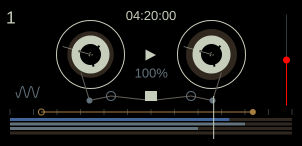

# Tape editing and performance controls

This pass implements documented tape operations using original software storage and control laws. It does not establish exact hardware parity or uninterrupted audio during heavy edits.

## Use

Open **Tape**, then **Tape edits → Tape editing** (also available under COM).

- **Tracks to edit** follows the selected track by default. Choose individual tracks or all four for grouped operations. The edit-group choice is available in the menu; track buttons still select the recording/drop destination.
- Shift-drag the tape display to select a time interval. Enable **Snap seek and selection to grid** and choose a bar, half-bar, beat or eighth-note grid. Bar divisions use four beats. IN/OUT also set the active interval.
- **Copy selection** preserves the source; **Lift selection** copies then silences it without shifting later audio. Cmd/Ctrl+C and X do the same in tape view.
- **Drop at playhead** overwrites destination audio and preserves the clipboard's relative track spacing. Its first included track maps to the selected destination; tracks that would extend past track four are omitted. Cmd/Ctrl+V drops.
- **Merge clipboard** mixes copied tracks onto the selected destination, using the mixer levels, pans, mutes and solos captured at copy time. **Bounce selection** renders the group in place onto the selected destination, leaving other sources intact. These replace destination samples in the interval rather than adding to them; mute source tracks when auditioning a bounce to avoid doubling.
- **Join cuts within selection** removes internal splice markers; it leaves audio in place. **Slide selection** moves audio without rippling later audio, including overlapping moves. The menu offers one-beat increments.
- Group edits have one atomic undo/redo action. History remains RAM-backed and bounded by the existing soft memory budget.

Tape encoders: blue scrubs, ochre sets loop-out, grey controls speed, orange controls recording level. Shift exposes slide-selection, loop-in, speed percentage and recording pan. Record level/pan affect captured audio, not the monitored source. Double-click restores each knob's default.

**Record count-in** offers off, one, two, four or eight beats. Press Record to start it. Tape writes and head movement wait until the countdown finishes; clicks sound even if the metronome is off. Stop cancels it. Changing the count setting applies to the next recording. Off preserves immediate recording.

Hold tape keys **4 / 5 / 6** for **brake / reverse / chop**, or use the matching buttons below the tape panel. These replace the former sequencer/metronome shortcuts in tape mode. Hold **brake**, **reverse** or **chop** for temporary performance actions. Brake freezes and silences tape; reverse inverts the current tape-speed direction; chop repeats a quarter-beat window starting at the press position. Release restores normal playback from the current head position. Stop, leaving tape view, losing focus and closing the editor release these actions.

## Evidence and limits

The official OP-1 field firmware1.7 guide describes slide/loop/speed/record level/pan (text extraction lines582–588), lift/drop/split (610–617), break/reverse/chop (610–624), and count-in/lift-all/merge-drop/join/grid (632–649). See [official guide](https://teenage.engineering/guides/op-1) and the local research specification.

The guide's hardware gesture arms recording then starts count-in with Play. This app keeps its existing Record gesture and adds an optional automatic count-in. Count length, brake envelope, chop window/duty and press/release semantics were not specified by the inspected text. The explicit software behaviours above are design choices. Join operates on boundaries within a selected interval; it does not reconstruct a hardware take database. Bar and half-bar divisions currently assume four beats per bar. Tape editing still takes the shared engine lock and can interrupt audio; see LIVE_AUDIO_DESIGN.md.

## Reel LCD (November 2026)

Tape mode now uses the full LCD for an original vector recreation of the supplied guide layout: selected-track number, two reels, tape path/rollers/head, transport direction, speed percentage, timecode, loop markers and four compact take lanes. Reels rotate from actual tape position, with no free-running timer. Stop freezes them; reverse moves them backwards; scrubbing updates them. The right red indicator follows recording Level, or Pan while Shift is held. It is a control-position indicator, not a measured input meter. Count-in and recording have separate centre indicators.

Click the display to seek; Shift-drag selects an interval. Pointer seeking and painting use the same timeline endpoints. The view automatically expands from sixteen seconds to cover recorded material and the playhead. The footer retains the tape bank number outside the LCD; tape style remains available in COM. Use the sequencer dropdown and tempo/metronome utility button for the shortcuts replaced by tape tricks.

The guide confirms the four normal and four shifted encoder roles and tape keys 1–8 ([firmware 1.7 guide, pages 38–40](https://assets.teenage.engineering/_img/69f248938d433104c4dd1846_original.pdf)). The supplied still establishes layout, not mechanical rotation rates, timecode units or detailed tape-pack physics. Reel speed/pack interpolation and centisecond timecode are original approximations. Compact lanes show track extents and splice boundaries; they do not recover a hardware take database, silent holes or its selected-take highlighting. Shift-blue still slides the chosen selection, rather than automatically discovering a take beneath the head. Record arming, take selection, exact tape colour and seamless live edits remain parity gaps.

Validation: all eight local CTest suites pass. Native rendering was inspected at 1320×640 and 1000×520. New checks cover shared seek geometry, reel movement, direction and Level/Pan display changes, normal/Shift encoder MIDI targets, and actual panel-button brake/reverse/chop press/release effects on tape position. This does not establish real hardware or commercial-DAW parity.
