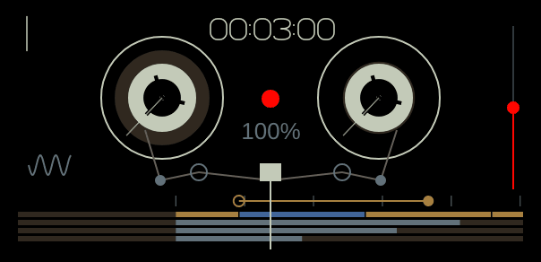
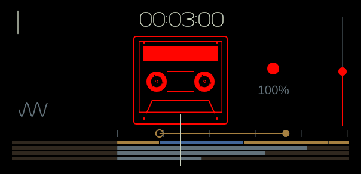
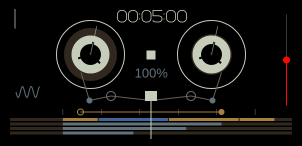
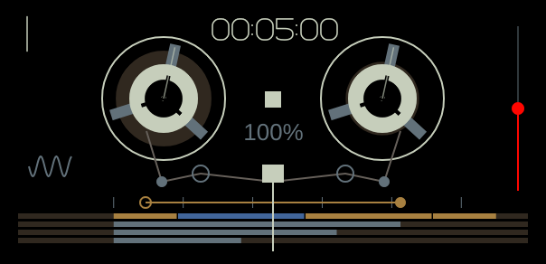
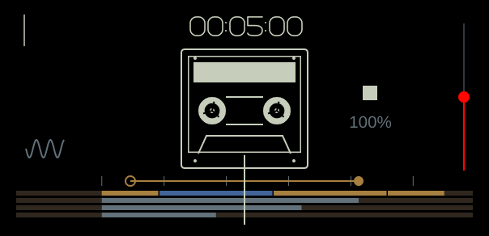
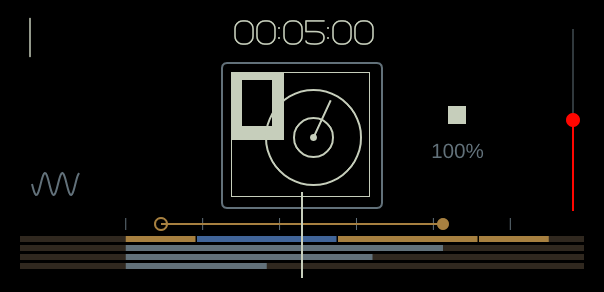

# Tape editing and performance controls

This pass implements documented tape operations using original software storage and control laws. It does not establish exact hardware parity. Heavy edits use the prepared ownership/job path; physical-device deadline validation remains open.

## Use

Open **Tape**, then **Tape edits → Tape editing** (also available under COM).

- **Tracks to edit** follows the selected track by default. Choose individual tracks or all four for grouped operations. The edit-group choice is available in the menu; track buttons still select the recording/drop destination.
- Shift-drag the tape display to select a time interval. Enable **Snap seek and selection to grid** and choose a bar, half-bar, beat or eighth-note grid. Bar divisions use four beats. IN/OUT also set the active interval.
- **Copy selection** preserves the source; **Lift selection** copies then silences it without shifting later audio. Cmd/Ctrl+C and X do the same in tape view.
- **Drop at playhead** overwrites destination audio and preserves the clipboard's relative track spacing. Its first included track maps to the selected destination; tracks that would extend past track four are omitted. Cmd/Ctrl+V drops.
- **Merge clipboard** mixes copied tracks onto the selected destination, using the mixer levels, pans, mutes and solos captured at copy time. **Bounce selection** renders the group in place onto the selected destination, leaving other sources intact. These replace destination samples in the interval rather than adding to them; mute source tracks when auditioning a bounce to avoid doubling.
- **Join cuts within selection** removes internal splice markers; it leaves audio in place. **Slide selection** moves audio without rippling later audio, including overlapping moves. The menu offers one-beat increments.
- Group edits have one atomic undo/redo action. History remains RAM-backed and bounded by the existing soft memory budget.

Tape encoders: blue scrubs, ochre sets loop-out, grey controls speed, orange controls recording level. Shift exposes slide-selection, loop-in, speed percentage and recording pan. Record level/pan affect captured audio, not the monitored source. Double-click restores each knob's default.

**Record count-in** offers off, one, two, four or eight beats. Press Record to start it. Tape writes and head movement wait until the countdown finishes; clicks sound even if the metronome is off. Stop cancels it. Changing the count setting applies to the next recording. Off preserves immediate recording.

Hold tape keys **4 / 5 / 6** for **brake / reverse / chop**, or use the matching buttons below the tape panel. These replace the former sequencer/metronome shortcuts in tape mode. Hold **brake**, **reverse** or **chop** for temporary performance actions. Brake freezes and silences tape; reverse inverts the current tape-speed direction; chop repeats a quarter-beat window starting at the press position. Release restores normal playback from the current head position. Stop, leaving tape view, losing focus and closing the editor release these actions.

## Evidence and limits

The official OP-1 field firmware1.7 guide describes slide/loop/speed/record level/pan (text extraction lines582–588), lift/drop/split (610–617), break/reverse/chop (610–624), and count-in/lift-all/merge-drop/join/grid (632–649). See [official guide](https://teenage.engineering/guides/op-1) and the local research specification.

The guide's hardware gesture arms recording then starts count-in with Play. This app keeps its existing Record gesture and adds an optional automatic count-in. Count length, brake envelope, chop window/duty and press/release semantics were not specified by the inspected text. The explicit software behaviours above are design choices. Join operates on boundaries within a selected interval; it does not reconstruct a hardware take database. Bar and half-bar divisions currently assume four beats per bar. Tape edits are prepared on the control/worker side and installed at an audio block boundary; the audio callback does not acquire the editing-model lock. See AUDIO_REWRITE_PROGRESS.md.

## Recording LCD and motion (0.4.2)

Each tape style now has its own original vector recorder display: Studio and Vintage reels, a Porta cassette, and a Disc Mini cartridge. Studio follows the supplied guide, and Porta is informed by inspected hardware footage. Vintage/Disc Mini details remain approximations. Timecode uses the app's monoline vectors. Mechanisms use published **actual signed tape travel**, so loop/chop wraps keep winding smoothly, MIDI/remote reverse changes direction, and Stop/brake/count-in freeze the mechanism. Angular rates and tape-pack sizes are software approximations.

The default sixteen-second strip scrolls beneath the centre head. **Mouse wheel over the LCD** zooms from two seconds to six minutes. **Double-click** switches six-minute overview/detail. The overview uses an absolute timeline; detail keeps the head centred. Click seeks and Shift-drag selects using the same scrolled coordinates as painting. The bar ruler follows effective tempo.

Existing selected-track material is ochre; the splice interval under the head is blue; other tracks are grey. Only the current continuous recording stroke is overlaid red, rather than the whole recorded track. This uses actual writes and resets at discontinuous seeks/loops. It does not recover silent holes or a complete hardware take database. The right red line shows recording Level (Shift: Pan), not input amplitude. Count-in, recording and playback have separate indicators.

Right-click transport/loop buttons to learn MIDI. Fine jog, record/finish, sample capture and tape edits remain available through [controller mappings](CONTROLLERS.md#recording-and-timeline-control-041). Recording retains Field Studio's existing single-press start/finish convention; hardware arming/key combinations are not newly implemented.

| Studio | Vintage |
|---|---|
|  |  |
| Porta | Disc Mini |
|  |  |

The focused `tape_motion` check covers loop-safe signed mechanism travel, brake/stop/scrub, shared scrolled seek geometry, a fixed head, recording-overlay bounds and style rendering. No broad local suite or CI watch was run for this pass. See [sources, observations and exact limits](research/TAPE_VISUAL_MOTION.md). This is progress toward visual parity, not a claim that every recording/tape feature now matches the hardware.
