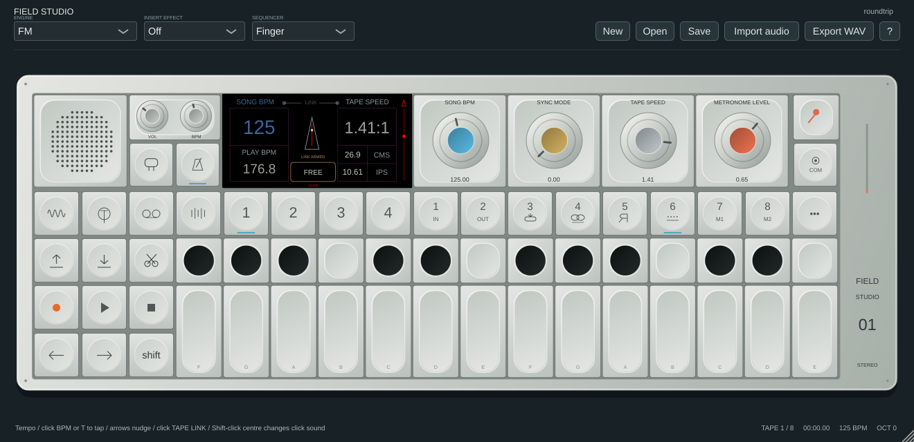
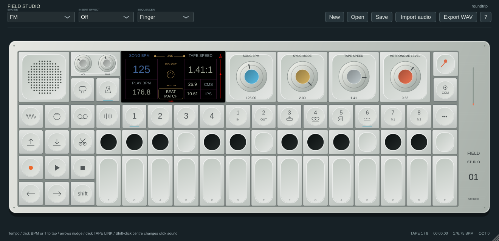
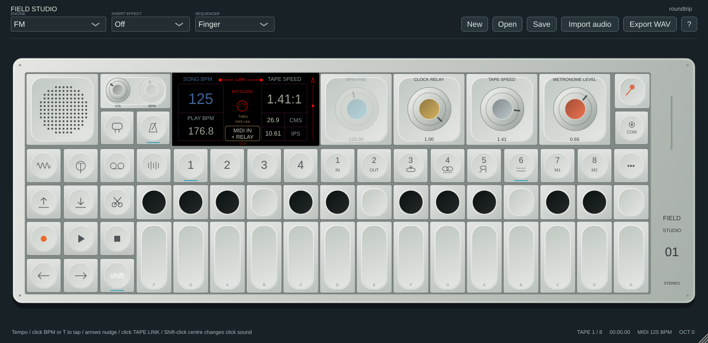

# Tempo and MIDI sync

Open the tempo page with the metronome-shaped button beside the input button, or COM → Tempo / sync page. It shows Song BPM, tape playback BPM, the actual tape-speed ratio and nominal cm/s / inches/s, clock status and metronome level. The layout follows the supplied tempo references using original vector graphics. [Official field guide, tempo section](https://assets.teenage.engineering/_img/69f248938d433104c4dd1846_original.pdf).

## Controls

| Control | Normal | Shift |
|---|---|---|
| Blue | Song BPM, coarse drag | Same BPM with finer drag sensitivity |
| Ochre | Free / MIDI receive / Beat Match (MIDI send) | Enable/disable received-clock relay |
| Grey | Base tape speed, including reverse | Base tape speed |
| Orange | Metronome level | Metronome level |

Click Song BPM, or press **T**, repeatedly to tap quarter notes. The last four accepted tap intervals are averaged; a gap over two seconds starts a new measurement. Song BPM is 30–240; Shift-blue and Shift-arrow nudges support 0.01 BPM precision. Left/right keys and the hardware-style arrow buttons nudge by 1 BPM, or 0.01 with Shift. Tempo entry is disabled while receiving MIDI clock or following a DAW; the saved song BPM remains the reference for tape-speed linking.

Click the centre illustration or the right-edge level strip to toggle the metronome. Shift-click the centre to cycle **Click / Wood / Beep** sounds. Shift-clicking the tempo button also toggles the metronome. These are original sounds, used during playback and record count-in. Count-in still clicks when the ordinary metronome is off; level zero silences both. Playback clicks follow the engine clock independently of tape speed and reverse. Rewind resets their phase; seeking sets phase from the seek time.

Click **TAPE LINK / UNLINKED** above the mode badge to toggle tape-speed linking. Click the mode badge to cycle modes; when following a DAW, clicking it first releases DAW follow. Mode and link/relay options are also available through COM. New link/relay options default off, retaining earlier project behaviour. Existing MIDI clock parameter IDs, values and choices are unchanged.

## Sync with compatible MIDI gear

This uses standard MIDI realtime clock at **24 messages per quarter note**, plus Start, Continue, Stop and Song Position Pointer. MIDI clock is independent of the selected note channel. See the [MIDI Association's message description](https://midi.org/about-midi-part-3midi-messages).

1. In standalone **Options → Audio/MIDI Settings**, enable the hardware's MIDI input and select the desired MIDI output. USB gear and DIN gear connected through an OS-visible MIDI interface use the same protocol. A device must actually support transmitting or receiving MIDI clock; assigning CC knobs alone does not establish clock support.
2. To drive an external sequencer/drum machine, choose **Beat Match / Send MIDI clock**, set the device to external MIDI sync and press Play. OPVYN sends clock while playing, Start from the beginning, SPP + Continue after a seek/resume, and Stop on stopping. Free mode generates no clock.
3. To follow external gear, choose **MIDI sync / Receive MIDI clock**, leave MIDI transport input enabled and start the external master. The page displays **WAIT CLOCK** until enough timing intervals arrive, then **EXT CLOCK** and a red link. The median follower rejects isolated timing outliers and expires its estimate after two seconds without clock. On timeout the engine returns to Song BPM; transport is not automatically stopped.
4. To pass the incoming stream to another compatible device, choose Receive, hold Shift and enable **CLOCK RELAY**. Clock and transport are forwarded once at their received sample offsets, even with MIDI thru enabled. Local clock generation is suppressed in receive mode. Keep routing one-way: connecting a device's output back to the same input can create a MIDI loop.

In a plugin, route MIDI input/output through the DAW. Some hosts filter realtime messages or do not expose instrument MIDI output. **Follow DAW transport and tempo** takes priority over incoming realtime transport; enable it through COM when the host should be master. A host can supply tempo even if it does not pass MIDI clock. Choose Send if you also want to generate a MIDI output stream from host transport, subject to the host's routing support. Relay is inactive while following a DAW.

This replaces a PO-specific sync choice with generic MIDI receive/send/relay. **It does not generate PO, analogue 1/16, modular gate or DIN Sync audio/voltage pulses**, and it does not host USB devices directly. For gear that accepts only analogue sync, use a suitable MIDI-to-clock interface. Standard MIDI receivers choose their own pattern division; MIDI itself stays at 24 PPQN rather than changing to four pulses per quarter note.

## Tape link behaviour

Unlinked playback preserves the selected tape rate independently of clock source. Playback BPM reads `Song BPM × abs(actual tape speed)`. The cm/s and IPS readings use nominal 19.05 cm/s / 7.5 IPS at 1×; they are software equivalents, not a physical transport measurement.

With link enabled:

- **Beat Match:** effective sequencer/LFO/metronome/output-clock BPM is Song BPM multiplied by the absolute base tape speed.
- **MIDI receive or DAW follow:** actual tape speed is base speed multiplied by effective external BPM / Song BPM. The underlying speed parameter and Song BPM stay unchanged. Reverse retains its sign.
- **Free:** the option is armed but inactive. MIDI receive also waits for a valid clock estimate before applying the ratio.

The engine clock is bounded to 30–300 BPM and the linked tape speed to −2×…2×; clipping limits the ratios at extremes. MIDI receive does not time-stretch audio or preserve pitch. Sound and tape timing can change when enabling link. Both link and relay settings, click sound, level and the existing metronome switch persist in projects/DAW state. New parameters support host automation, MIDI learn and MCP parameter control.

## Screenshots and validation

Automated tests cover tap averaging, fine nudges, external ownership, ratio linking/unlinking, Beat Match master tempo, relay timestamps and duplicate suppression, saved settings, normal/Shift encoder targets, independent metronome timing, original click sound choices and native rendering. Existing clock tests cover 24-PPQN generation, fractional sample spacing, jitter, tempo changes, expiry, transport and seeks. Relay screenshots use a simulated incoming stream through the actual processor.

Exact hardware algorithms, metronome timbres, tap window, nudge acceleration, phase locking and animation timing are not established. The metronome animation illustrates the current BPM while playing; it is not an audio-phase measurement. Clock receipt estimates tempo; there is no continuously corrected external tape phase lock or calibrated hardware/USB latency compensation. Real-device clock tests and host-specific routing coverage remain open. See [known issues](KNOWN_ISSUES.md) for the shared-engine lock limitation.
