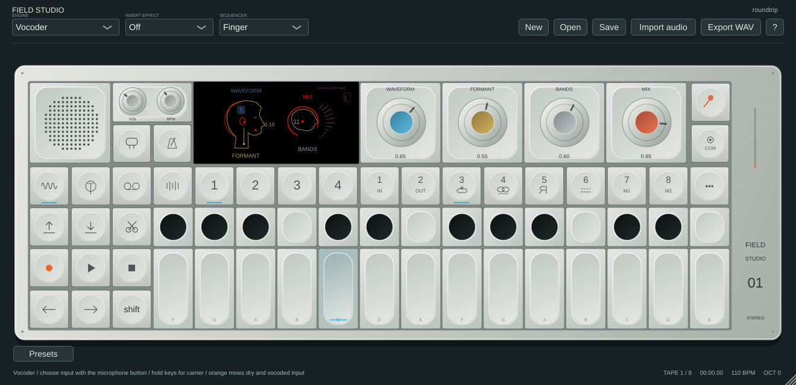
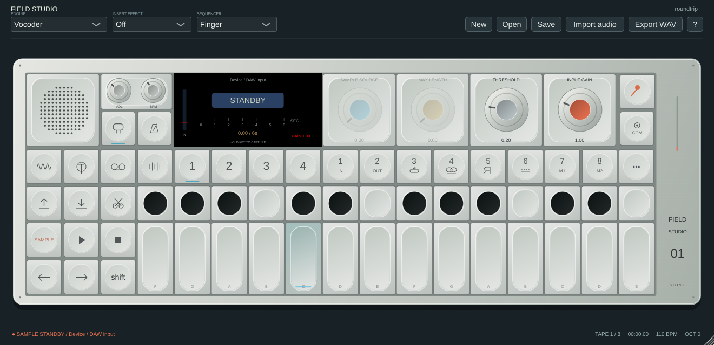
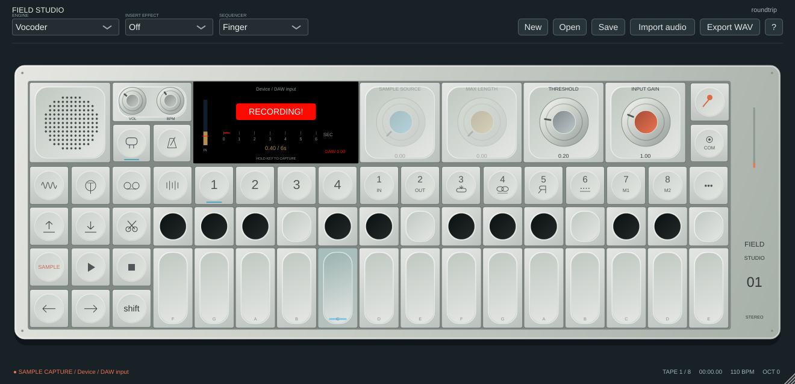

# Vocoder, microphone and computer-audio sampling

Open **Sampling / input** with the **orange microphone button at the top right**. Click it again, or click the LCD's source-name header, to choose an input. COM also provides Sampling / input page and Choose microphone / computer audio source. The speech-bubble button beside Tempo opens the same page; Shift-click it to toggle direct input monitoring.

The layout and four vocoder roles follow the supplied screenshots and [official OP–1 field guide](https://teenage.engineering/guides/op-1). Screen graphics and DSP are original; exact sound, scales and hardware gestures are unverified.

## Record a microphone or interface

1. Open Sampling, click the source header and select your microphone/interface. Alternatively choose **Use standalone / DAW audio input** and configure the input in standalone **Options → Audio/MIDI Settings**, or route a track into the plugin's main input in the DAW.
2. Blue chooses **Selected input** or **Main output**. Choose Selected input for the microphone. Ochre chooses the maximum length: **6 / 20 / 60 / 120 seconds**, default 20. Grey sets the amplitude threshold, orange sets input gain from 0–4×. The input meter reflects the selected signal; its red marker shows the threshold.
3. Click **ARM / RECORD**, or press the red Record button while on this page. With threshold zero, capture starts on the next audio callback. With a positive threshold, **STANDBY** waits until a sample crosses it. The crossing sample is included; earlier audio is not. There is no pre-roll buffer.
4. The LCD changes to **RECORDING!**, with elapsed time and a length ruler. Press Stop, click the recording badge, or press Shift-record to finish. Reaching the length cap also finishes automatically. The capture is installed into Sampler; trim start/end and loop markers there. The current sample is retained if an armed capture finishes without recording any frames.

For the reference's held-key workflow, **Shift-click ARM / RECORD** to enable **HOLD KEY TO CAPTURE**, then arm recording and hold a played or typed MIDI note while making sound. Both a held key and the threshold condition are needed to start. Release all keys to finish. Key gating currently resolves at callback boundaries, not exact per-event offsets; the message-thread timer commits the finished sample. With threshold zero, held-key capture can intentionally record silence.

Shift-record outside the input page starts/finishes the selected source. COM → Sampler retains explicit Record input sample and Resample main output commands when Sampler is selected. Input gain affects the routed input used by sampling, vocoding, input monitoring and input recording; it does not amplify Main output resampling. Source and maximum length are fixed for an in-progress capture even if their host parameters change; gain and threshold remain editable.

Input device selection turns direct monitoring off. Headphones or separate output routing are useful when monitoring a microphone. The live connection continues feeding the selected input until you choose **Use standalone / DAW audio input**, change the audio engine's sample rate, open a project or create a new project. Hardware connections are not saved/reopened automatically. Capture parameters persist in projects and DAW state and support host automation, MIDI learn and MCP parameter editing. MCP does not currently start/stop capture or choose hardware devices.

## Capture audio from other apps

A source must be exposed to the operating system or routed to Field Studio. The app cannot read arbitrary audio from a browser tab by URL. Protected streams, exclusive drivers, device permissions and host routing can limit capture.

| Platform | Computer-audio source |
|---|---|
| Windows | Select **System loopback: [output device]** in the source picker. This records the shared Windows output mix from that endpoint, independently of the JUCE standalone output driver. Apps must play through the selected endpoint. ASIO-exclusive output is not necessarily part of that mix; route it through an interface loopback or DAW/plugin input instead. |
| Linux | Select an output **Monitor** from the PulseAudio / PipeWire-Pulse input list. The PipeWire PulseAudio compatibility server and libpulse runtime must be available for this picker. You can route an individual app or a monitor into the **Field Studio capture / Field Studio input** stream using your audio mixer. Standalone/DAW input remains available when the extra backend is unavailable. |
| macOS | Route the desired app/system audio through a virtual input such as **BlackHole**, then select that input. A Multi-Output Device can send audio to BlackHole and your listening device. This release uses CoreAudio inputs and does **not** implement automatic ScreenCaptureKit/process-tap capture. Virtual drivers are not bundled or installed automatically. |
| VST3 / AU | Route another audio track/bus into the plugin's main audio input using the host, or explicitly choose an external capture input. Hosts differ in how they expose input buses and microphone permissions. |

Windows loopback follows [Microsoft's shared-endpoint model](https://learn.microsoft.com/en-us/windows/win32/coreaudio/loopback-recording); the backend uses [miniaudio's loopback/capture API](https://github.com/mackron/miniaudio/blob/0.11.23/examples/simple_loopback.c). Linux routing uses [PipeWire/WirePlumber streams and monitor sources](https://pipewire.pages.freedesktop.org/wireplumber/policies/linking.html). For macOS, follow [BlackHole's official setup guide](https://existential.audio/blackhole/support/) and grant microphone/input access when requested; see [Apple's permission instructions](https://support.apple.com/en-ca/102071).

Loopback can also capture Field Studio's own output. Leave direct monitoring off for straightforward sampling. When vocoding computer audio, route the instrument output to a different device/bus from the captured output, or isolate the source app through virtual/DAW routing, to avoid feeding processed output back into the input.

To sample **Field Studio itself**, choose **Main output**, arm, and play synth notes or tape. This captures the processed stereo output including master effects. It is an internal resample, requiring no external loopback device. To sample an **audio file**, use Import audio or the source picker's Import audio file action. Supported imports remain WAV/AIFF/FLAC/Ogg, up to 120 seconds; MP3/video extraction is not included.

## Vocoder controls

Choose **Vocoder** from the engine selector and select a microphone, interface, loopback or routed DAW input using the microphone button. Return to Synth/T1 and hold notes to supply the carrier. Direct input monitoring is not required.

| Encoder | Actual role |
|---|---|
| Blue — Waveform | Eight original carrier shapes: saw, square, triangle, sine, narrow pulse, saw/harmonic blend, wide pulse and saw/double-pulse blend. |
| Ochre — Formant | Shifts the mapping of analysis-band envelopes across carrier bands. Display uses an original normalized −1…+1 scale. |
| Grey — Bands | Chooses 4–16 analysis/synthesis bands on a logarithmic frequency grid. Changing count resets the band-filter history. |
| Orange — Mix | Dry input ↔ vocoded output, 0–100%. Fully wet requires held carrier notes; fully dry passes input without keys. |

The original head/voice illustration follows the parameters. Mouth motion and source meter reflect actual selected-input level; the speech rays reflect the analysis envelopes. The top-right source label names the current route rather than showing a fictional radio/microphone source. Vocoder analysis is a mono sum of the selected stereo input, with an original stereo carrier. Main output is reserved for sampling and is not fed back as the vocoder modulator.

These corrections can change existing Vocoder patches: former macros blended a carrier and affected unrelated filtering; they now have the named roles above. There are no manufacturer algorithms, filter measurements, factory voice samples, radio, Bluetooth-input emulation or exact hardware sound claims.

## Screenshots and validation

Automated tests cover independent vocoder controls, bounded finite audio, wet-without-carrier silence, dry passthrough, stereo capture, threshold crossing, gain, empty-capture preservation, held-key finish, saved controls, FIFO overflow/underflow/backlog bounds, input/output resampling and native UI rendering. Screenshots use generated test signals through the real processor. Linux application/MCP and core sanitizer suites are supplemented by the release's Windows/macOS/Linux builds.

Physical microphone/interface/loopback listening tests and long-duration cross-device clock-drift tests have not been completed. External capture uses a bounded stereo FIFO and resamples to the instrument rate. Underflow supplies silence; overflow/backlog reclamation drops frames. Opening sources and committing samples still use the shared control lock, so seamless live audio is not established. Capture length is a maximum, not a guarantee against memory exhaustion. See [known issues](KNOWN_ISSUES.md) and [audio-backend setup](AUDIO_BACKENDS.md).
