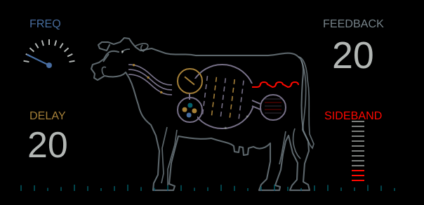
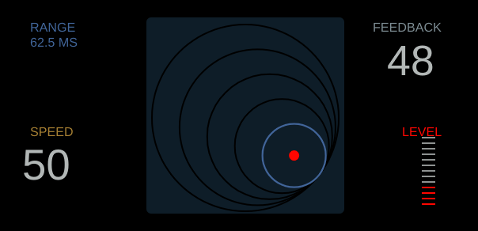

# CWO / Delay: observed motion and behaviour

The previous screens copied static layout while leaving most CWO mechanisms fixed and adding an unrelated Delay wobble. This pass uses firsthand hardware demonstrations alongside the official guide. It is not a claim of exact parity.

## Evidence inspected

**Delay — [SON WU, OP-1 field tutorial](https://www.youtube.com/watch?v=jU0upSQLuuY)**. Frame comparisons at 175, 200 and 215 seconds show the highlighted ring and its red centre changing with Range (250 → 500 → 1000 ms). During the 155–170 second Speed sweep (99 → 45 → 29 → 16 → 0), the selected range circle remains stable. Feedback changes its numeric readout; input changes its meter. No autonomous ring wobble is visible in the sampled held-control frames. The input explanation starts near 40 seconds. The similar-time comparison at 4:12–6:12 demonstrates darker, rate-reduced echoes from the low-range/slow-speed combination.

**CWO — [SON WU, OP-1 field tutorial](https://www.youtube.com/watch?v=INzzjy-GiMY)**. Inspected control sections start at 0:42 (sideband), 2:10 (frequency), 4:30 (feedback), and 6:00 (delay). The endpoints select lower/upper shifted sidebands; intermediate positions include both. Feedback zero retains processed sound, and increasing it introduces original sound too. The coloured internal wheel changes orientation between frames. The recording does not provide enough resolution/control isolation to establish exact animation timing or every compartment binding.

**Primary manufacturer material:** [field guide](https://assets.teenage.engineering/_img/69f248938d433104c4dd1846_original.pdf) establishes labels and layout. [TE's CWO announcement](https://now.teenageengineering.com/post/51638816069/op-1-os-update-13585) explains the four-compartment signal-processing metaphor and identifies a frequency-shifting delay. Its text and static SVG illustrations do not provide animation equations.

The footage is from 2022, with undisclosed firmware. The guide is newer. Neither establishes exact equivalence to the current firmware. Public videos were inspected at 640×360, using manually rectified LCD crops; geometric measurements are approximate. Source IDs, hashes, timestamps, bounded observations and unresolved questions are retained in [effect-motion-evidence.json](effect-motion-evidence.json). Source video, transcripts and screenshots are not distributed with the application.

## Resulting implementation

- **Delay:** Range selects a nested circle and moves the red point to its centre. Remove autonomous wobble. Speed/Feedback update readouts; Level/Input updates its meter. Keep geometry unchanged when only Speed changes, matching the sampled frames.
- **CWO:** integrate separate wheel and flow phases so frequency and delay affect motion rates without phase jumps when a control changes. Feedback adds return-loop activity; sideband changes the chamber/meter cue. Detailed rates and particle/colour choices are original interpretations, not recovered hardware behaviour.
- **CWO sound:** blend lower/upper sidebands, include both at midpoint, and introduce a bounded dry component as Feedback rises. The exact mix curve remains unmeasured.
- **Delay sound:** Level governs incoming material; existing echoes survive closing it. Preserve the direct signal and add echoes. Use prefiltered sample holding at slow clock settings, so equal-time range/speed combinations can have different fidelity. The colour model and time law remain independent approximations.
- **Shift:** fine-adjust the same four controls. The optional software wet/dry override moves to COM; new CWO/Delay selections and native imports use full module output. Saved projects retain their existing blend settings.

Tests isolate ring/readout/meter regions, compare held controls at different times, and verify each CWO control affects its mechanism. Tone tests check both sidebands and feedback/carrier behaviour. Impulse tests check timing, continuing echoes after input closure, and source preservation. Equal-time two-tone tests verify the fidelity trend. Allocation/free, bounded-output and sanitizer checks cover the new DSP.

Unclosed gaps: exact raw travel and range table, timing/gain/frequency curves, buffer/filter laws, every animation binding/rate, hardware-device comparisons, and exhaustive present-firmware/pixel parity.

## OPVYN previews

These are native application renders, not hardware recordings. CWO timing remains approximate.

